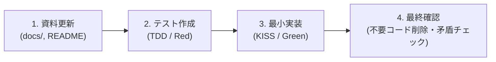
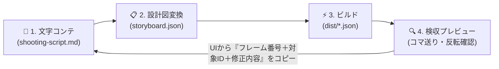

# AIエージェント向け開発ガイドライン (`AGENTS.md`)

> **TL;DR（3秒でわかるルール）**
> 1. **資料ファースト**: コードを書く前に必ず `docs/` と `README.md` を更新する。
> 2. **文字コンテ駆動**: `shooting-script.md`（文字コンテ）→ `storyboard.json` → `Lottie JSON` の一貫フローを守る。
> 3. **TDD（テスト駆動）**: 実装前に必ず失敗するテストを書く（`node --test`）。
> 4. **KISS & エフェクトのモジュール化**: 後方互換は一切捨て、Node.js 標準機能だけでシンプルに書く。キラーエフェクトは `src/effects/` に1ファイル1エフェクトで追加する。
> 5. **セキュア第一・a11y第二・日本語コミット**: 外部依存ゼロ・パストラバーサル防止、キーボード＆スクリーンリーダー完全対応のプレビューUI、コミット・PRはすべて日本語。

---

## 1. プロジェクト方針

- 本プロジェクトは **「ロゴ・アイコン・UIイラスト・キャラクターなど、あらゆるSVG素材と文字コンテ（`shooting-script.md`）/ 宣言的コンテ（`storyboard.json`）から汎用的なLottieアニメーションを構築・検収・修正指示できるCLIツール（`svg2lottie-cli`）」** です。
- **`npm` / `npx` / `pnpm` / `yarn` のすべてのパッケージマネージャーで同じように起動可能**なスタンドアロンCLIとして設計します。
- **後方互換やデータ移行は一切考慮不要**です。常に最新の理想的な設計・実装へと迷わず書き換えてください。
- コードは常に **KISS（Keep It Simple, Stupid）原則** に則り、誰が見ても最もシンプルで無駄のない状態を維持してください。



---

## 2. アニメーション制作・修正の黄金サイクル（文字コンテ＆プレビュー駆動）

人間（ディレクター／デザイナー）とAIエージェントがストレスなく協業し、**同じミスを二度と繰り返さない**ための制作フローです。



### どのように Agent に修正を伝えるか（修正方法の標準化）
従来の「口頭や曖昧な箇条書きで伝えると、直したはずの1f目の透過がまた壊れる」といった手戻りを防ぐため、以下の2つの仕組みを提供します：

1. **プレビューUI内蔵「AI修正指示ジェネレーター」**:
   - 検収プレイヤー上で気になったフレームで一時停止し、対象レイヤーと修正メモを入力すると、**「対象JSON・シーン名・正確なフレーム番号・対象レイヤーID・修正指示・回帰防止チェック」** を定型Markdownとしてワンクリックでコピーできます。
2. **`shooting-script.md` の構造化フォーマット**:
   - シーンごとの演出定義に加え、末尾に **`## 絶対維持ルール（回帰防止ガード）`** と **`### 修正履歴（フレーム・対象ID明記）`** を記述することで、どのエージェントが読んでも既存仕様を壊さずピンポイントで修正できます。

---

## 3. 厳守すべき4ステップ開発サイクル

すべての機能追加・変更は以下の順序を**絶対に飛ばさず**実行してください。

1. **資料を更新する（Documentation First）**
   - 先に `docs/requirements.md`、`docs/data-model.md`、`docs/api-specification.md`、`docs/prompt.md`、`README.md` を更新し、仕様間の矛盾や古い情報が無いことを確認してください。
2. **テストを書く（TDD: Test-Driven Development）**
   - Node.js 標準テストランナー（`node --test`）を使用し、実装前に期待する振る舞いのテストコード（`tests/*.test.mjs`）を書きます。
3. **最小実装する（Minimal & KISS Implementation）**
   - テストを通すために必要最小限かつ最も読みやすいコードだけを `src/` に実装します。
   - 「いつか使うかもしれない機能」や「レガシー互換用ラッパー（`legacy-*`）」は一切作らないでください。
4. **不要コード・資料矛盾がないか最終確認する（Clean Up & Verify）**
   - 未使用の関数・変数・ファイルが残っていないか、`docs/` と `src/` の引数・型・挙動が完全一致しているかを確認します。

---

## 4. 優先順位（Security 1st / a11y 2nd）

### セキュア第一（Security First）
- **ゼロ外部依存（Zero Dependencies）**: サプライチェーン攻撃を防ぐため、ランタイムは Node.js 標準モジュール（`node:fs`, `node:path`, `node:http`, `node:test` 等）のみで構成します。
- **パストラバーサル防止**: CLI のファイル入出力およびプレビューサーバーでは、ベースディレクトリ外へのアクセス（`../` 等）を正規化後に厳密に検証し、違反時は即時拒否（`403 Forbidden` または例外スロー）します。
- **ローカルバインド限定**: プレビューサーバーは必ず `127.0.0.1` にのみバインドし、外部ネットワークへ公開しません。
- **SVG入力検証・無害化**: 読み込む SVG 内の `<script>`、外部エンティティ参照（`<!ENTITY`）、イベントハンドラ属性（`onload` 等）、上限サイズ超過（10MB超）を拒否します。
- **セキュリティヘッダー**: プレビューサーバーは `Content-Security-Policy`、`X-Content-Type-Options: nosniff`、`X-Frame-Options: DENY` を付与します。

### a11y第二（Accessibility Second）
- **プレビューUI（検収スタジオ）のアクセシビリティ**:
  - すべての操作ボタン・スライダー・セレクトボックス・修正指示フォームに明確な `<label>` または `aria-label` を付与します。
  - キーボード操作（`Space`: 再生/停止、`ArrowLeft` / `ArrowRight`: 1フレーム移動、`Home`: 先頭へ戻る）に完全対応します。
  - 状態変化（読み込み完了・現在のフレーム・再生状態・コピー完了・エラー）は `<output aria-live="polite">` でスクリーンリーダーへ通知します。
  - OS設定の `prefers-reduced-motion: reduce` 検知時は自動再生（`autoplay`）をOFFにして開始します。
  - Day & Night（ライト／ダーク／色反転）モードでも十分なコントラスト比（WCAG AA 4.5:1 以上）を確保します。
- **CLI出力のアクセシビリティ**:
  - `NO_COLOR` 環境変数を尊重し、絵文字や色に頼らなくても成功（`[OK]`）・エラー（`[ERROR]`）と対処法が一目でわかるテキスト出力にします。

---

## 5. ディレクトリ構成と責務（エフェクトのモジュール化）

キラーエフェクトをいつでも独立して追加・テストできるよう、`src/effects/` 配下に1ファイル1エフェクトでモジュール化します。

```text
svg2lottie-cli/
├── AGENTS.md                     # 本ファイル（全体像・規約・KISS原則・開発サイクル）
├── README.md                     # プロジェクト概要・図解・npm/npx/yarn/pnpm起動手順
├── package.json                  # bin定義・スクリプト定義（外部依存ゼロ、ESM）
├── docs/                         # 仕様・要件ドキュメント置き場（Single Source of Truth）
│   ├── requirements.md           # 要件定義書（文字コンテ・検収UI・エフェクトモジュール要件）
│   ├── data-model.md             # データモデル設計（文字コンテ & Storyboard JSON & Lottie構造）
│   ├── api-specification.md      # API・CLI仕様書（コマンド・エフェクトAPI・HTTP仕様）
│   └── prompt.md                 # AIエージェント指示プロンプト集（新規制作＆修正指示テンプレート）
├── src/                          # ソースコード
│   ├── path-parser.mjs           # SVG Path(d) & HEX色 → Lottieベジェ頂点・中心座標変換
│   ├── svg-extractor.mjs         # セキュアSVG検証・viewBox取得・ID別Path抽出
│   ├── shooting-script.mjs       # 文字コンテ(shooting-script.md)解析・テンプレート生成・検証
│   ├── effects/                  # キラーエフェクト・モジュール群（随時追加可能）
│   │   ├── index.mjs             # エフェクトレジストリ（一覧・ディスパッチ）
│   │   ├── bleed-fade.mjs        # 滲んだフェードイン／アウト（ガウスブラー＋全方位拡縮＋加算マスク）
│   │   ├── move-slide.mjs        # イージング移動・展開アニメーション
│   │   ├── trim-stroke.mjs       # 一筆書き枠線アニメーション（Trim Paths）
│   │   └── powder-scatter.mjs    # 粉飛散パーティクルエフェクト（Powder Ending）
│   ├── lottie-builder.mjs        # Storyboard定義＋エフェクト群 → Lottie JSON 構築エンジン
│   ├── preview-server.mjs        # 検収・AI修正指示生成スタジオ付きローカルサーバー
│   └── cli.mjs                   # CLIエントリポイント（init / build / preview）
└── tests/                        # TDDテストスイート（node:test）
```

---

## 6. コーディング規約・Git運用ルール

- **言語・モジュール形式**: Node.js (v20+) ES Modules (`.mjs` / `"type": "module"`)、JSDoc による型注釈を記述。CLI先頭には必ず `#!/usr/bin/env node` を付与。
- **関数の粒度**: 1関数1責務（純粋関数を基本とし、副作用のあるファイルI/OやHTTPは `cli.mjs` / `preview-server.mjs` に隔離）。
- **命名規則**:
  - ファイル名: `kebab-case.mjs`
  - 関数・変数名: `camelCase`
  - 定数: `UPPER_SNAKE_CASE`
- **コミット・PR規約（日本語必須）**:
  - コミットメッセージおよびプルリクエストのタイトル・本文は**すべて日本語**で記述します。
  - フォーマット例:
    - `docs: 文字コンテ・検収プレビュー・エフェクトモジュール仕様を追加`
    - `test: キラーエフェクト群と文字コンテパーサーの単体テストを追加`
    - `feat: Storyboard JSONとエフェクトモジュールからLottieを生成する最小実装を追加`
    - `refactor: 不要なヘルパーを削除しKISS原則に沿って整理`
