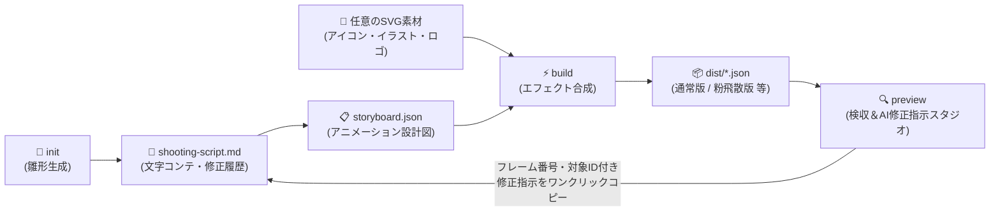
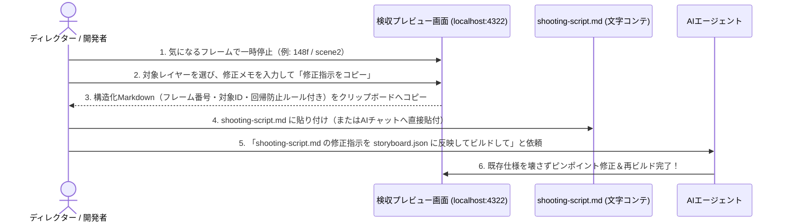

# svg2lottie-cli

> **3秒でわかる概要**
> **アイコン・UIイラスト・キャラクター・ロゴなど、あらゆるSVG素材**と**文字コンテ（`shooting-script.md`）**から、**キラーエフェクト付きのLottieアニメーション（JSON）**を構築し、**ブラウザ検収スタジオでコマ送り確認＆AIへの修正指示プロンプトをワンクリック生成**できる汎用CLIツールです。




---

## 対応ユースケース（ロゴだけじゃない！）

| 用途 | 作れるアニメーション例 |
|---|---|
| **UIアイコン・マイクロインタラクション** | 一筆書き（`trim-stroke`）で描かれるチェックマーク、滲みながら切り替わる状態アイコン |
| **ヒーローイラスト・キャラクター演出** | 複数パーツが時間差でスライド展開（`move-slide`）し、切手型マスク内で滲み出る（`bleed-fade`）演出 |
| **バッジ・エフェクト・ローディング** | 表示後に粉になって外向きに飛散して消える（`powder-scatter`）ループアニメーション |
| **ブランド・サービスロゴ** | テキストからイラストへのクロスフェード変身＋外枠一筆書き＋フィニッシュ |

---

## 5つのコア機能

1. **📝 文字コンテ駆動（`shooting-script.md`）**:
   - 専門的なLottieの知識がなくても、日本語の「文字コンテ（台本）」からアニメーションを構築可能。
2. **🔍 インタラクティブ検収＆AI修正指示スタジオ（`preview`）**:
   - コマ送り（`1f`単位）・速度変更（`0.25x〜1.5x`）・シーンジャンプ・Day & Night 色反転（CSS `invert`）確認に加え、**「今のフレーム・今のレイヤーに対するAI修正指示」をワンクリックでMarkdownコピー**できます。
3. **✨ モジュール化されたキラーエフェクト（`src/effects/`）**:
   - `bleed-fade`（ガウスブラー＋センター全方位拡縮＋はみ出し防止加算マスク）
   - `move-slide`（Cubic Bezier イージング移動・展開）
   - `trim-stroke`（右上から左回り等の自由な一筆書き枠線）
   - `powder-scatter`（頂点サンプリングによる粉飛散パーティクル＆完全透過）
   - 新しいエフェクトも `src/effects/` に1ファイル追加するだけで拡張可能。
4. **🛡️ セキュア第一（外部依存ゼロ）**:
   - Node.js 標準モジュールのみで動作。サプライチェーン攻撃リスクゼロ、パストラバーサル防止、SVG無害化検査を標準搭載。
5. **♿ a11y第二（アクセシビリティ完全対応）**:
   - キーボードショートカット（`Space`, `←`, `→`, `Home`）、スクリーンリーダー通知（`aria-live="polite"`）、`prefers-reduced-motion` 自動再生抑制に対応。

---

## クイックスタート（`npm` / `npx` / `pnpm` / `yarn` 全対応）

どのパッケージマネージャー・ランナーからでも同じ引数で起動できます。

### 1. プロジェクト雛形（文字コンテ＋設定＋サンプルSVG）を生成する

```bash
# npx の場合
npx svg2lottie-cli init

# pnpm の場合
pnpm dlx svg2lottie-cli init
# (リポジトリ内なら: pnpm init-project または npm run init)

# yarn の場合
yarn dlx svg2lottie-cli init
```

実行すると以下の3ファイルが生成されます：
- `shooting-script.md` — 人間が書き、AIに指示を出すための**文字コンテ**
- `storyboard.json` — エフェクトとフレーム配分を定義する**設計図**
- `svg/scene0.svg` — サンプルのSVG素材

### 2. Lottie JSON をビルドする

```bash
npx svg2lottie-cli build --config storyboard.json --out dist
# または: npm run build / pnpm build / yarn build
```

### 3. 検収プレビュー＆AI修正指示スタジオを起動する（最重要！）

```bash
npx svg2lottie-cli preview --dir . --port 4322
# または: npm run preview / pnpm preview / yarn preview
```

ブラウザで `http://127.0.0.1:4322` を開きます。

---

## 💡 どのように AI エージェントへ修正を伝えるか？（改善された修正フロー）

「直したはずの1f目の透過がまた壊れた」「どのシーンのどのパーツかうまく伝わらない」を防ぐため、以下の手順で修正を伝えます。



### プレビュー画面が出力する構造化修正指示の例

```markdown
### 修正指示 (scene2 / 148f付近)
- **対象ファイル**: `logo-animation.json`
- **対象シーン・フレーム**: `scene2` (`148f` / 全560f)
- **対象レイヤーID**: `o`
- **現状の課題と修正内容**: イラスト `o` の出現タイミングが早いので、フェードイン開始を `144f` から `154f` へ10フレーム遅らせてください。
- **回帰防止チェック（壊してはいけない既存仕様）**:
  - `0f` 待機時の透過 `0%` を維持すること
  - ガウス効果がマスク領域外にはみ出ないこと（`clipMask: true` 維持）
  - 背景透過・単色構成を維持すること
```

---

## ディレクトリ構成

```text
svg2lottie-cli/
├── AGENTS.md                     # AIエージェント向け開発ガイドライン
├── README.md                     # 本ドキュメント
├── package.json                  # npm / npx / pnpm / yarn 対応定義（外部依存ゼロ）
├── docs/                         # 仕様・要件ドキュメント
│   ├── requirements.md           # 要件定義書
│   ├── data-model.md             # データモデル設計（文字コンテ & Storyboard & Lottie）
│   ├── api-specification.md      # CLI・エフェクトモジュール・HTTP仕様書
│   └── prompt.md                 # AIエージェント用プロンプト集（制作・修正テンプレート）
├── src/                          # ソースコード
│   ├── path-parser.mjs           # SVG Path(d) & カラーコード変換エンジン
│   ├── svg-extractor.mjs         # セキュアSVG解析・ID別Path抽出モジュール
│   ├── shooting-script.mjs       # 文字コンテ(shooting-script.md)解析・生成・修正指示整形
│   ├── effects/                  # キラーエフェクト・モジュール群
│   │   ├── index.mjs             # エフェクトレジストリ
│   │   ├── bleed-fade.mjs        # 滲んだフェードイン／アウト（ガウス＋全方位拡縮＋加算マスク）
│   │   ├── move-slide.mjs        # イージング移動・展開
│   │   ├── trim-stroke.mjs       # 一筆書き枠線（Trim Paths）
│   │   └── powder-scatter.mjs    # 粉飛散パーティクル（Powder）
│   ├── lottie-builder.mjs        # Storyboard + エフェクト合成エンジン
│   ├── preview-server.mjs        # 検収＆AI修正指示スタジオ付きローカルサーバー
│   └── cli.mjs                   # CLIエントリポイント（init / build / preview）
└── tests/                        # TDDテストスイート（node --test）
```

---

## コマンド早見表

| やりたいこと | `npx` | `npm` | `pnpm` | `yarn` |
|---|---|---|---|---|
| **雛形を作る** | `npx svg2lottie-cli init` | `npm run init` | `pnpm init-project` | `yarn init-project` |
| **ビルドする** | `npx svg2lottie-cli build` | `npm run build` | `pnpm build` | `yarn build` |
| **検収プレビュー** | `npx svg2lottie-cli preview` | `npm run preview` | `pnpm preview` | `yarn preview` |
| **テスト実行** | `node --test` | `npm test` | `pnpm test` | `yarn test` |
