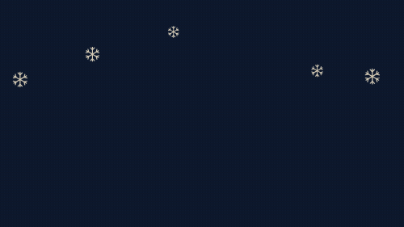
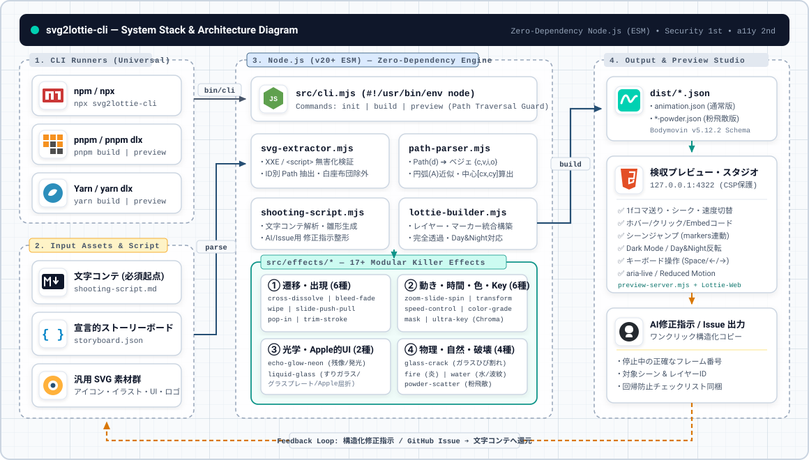
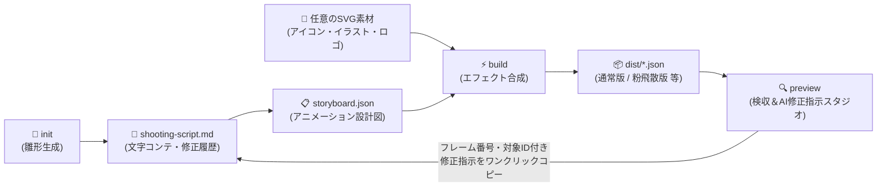
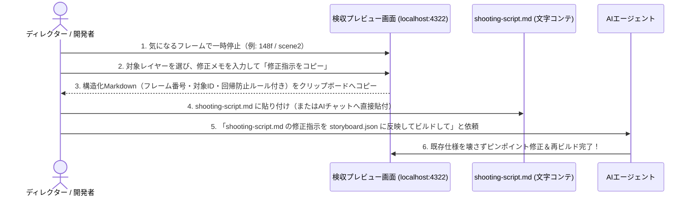

# svg2lottie-cli

> **3秒でわかる概要**  
> **アイコン・UIイラスト・キャラクター・ロゴなど、あらゆるSVG素材** と **文字コンテ**（`shooting-script.md`）から、 **キラーエフェクト付きのLottieアニメーション**（JSON）を構築し、 **ブラウザ検収スタジオでコマ送り確認＆AIへの修正指示プロンプトをワンクリック生成** できる汎用CLIツールです。

[](https://eijikobayashi.github.io/svg2lottie-cli/)

> 🌐 **ブラウザ上で今すぐ動かせるオンライン検収スタジオ**: [https://eijikobayashi.github.io/svg2lottie-cli/](https://eijikobayashi.github.io/svg2lottie-cli/)  
> （コマ送り、反転・Day & Night確認、AI修正指示プロンプト生成がGitHub Pages上で試せます）  

---

## 🎨 制作実績・ショールーム（3つの実例）

GitHub Pages 上で、アスペクト比の異なる3種類の実用的なアニメーションを直接再生・検収できます。

| 作品名             |                                           プレビュー (GIF)                                           | アスペクト比 / 解像度                   | 演出内容・特徴                                                                                         | Lottie JSON                                                            |
| :----------------- | :--------------------------------------------------------------------------------------------------: | :-------------------------------------- | :----------------------------------------------------------------------------------------------------- | :--------------------------------------------------------------------- |
| **ビーチロゴ**     |  | **正方形 (1:1)**<br/>600 × 600px        | 太陽の上昇・脈動、ヤシの木の左右スライド出現、波の重層パララックススライド、文字の弾性ポップイン       | [`beach-island-square.json`](./docs/dist/beach-island-square.json)     |
| **サマービーチ**   |  | **横長ワイド (2.46:1)**<br/>800 × 325px | 雲の左右スライド、波の多層パララックス流動、中央タイポグラフィの弾むポップイン                         | [`tropical-vibes-wide.json`](./docs/dist/tropical-vibes-wide.json)     |
| **クリスマスの家** |  | **標準ワイド (16:9)**<br/>800 × 450px   | 雪降る夜の家、窓の灯りの灯火、煙突の煙、降雪・星の多重ループ（四角い背景を除外した完全透過・反転対応） | [`merry-christmas-house.json`](./docs/dist/merry-christmas-house.json) |

---

## 🧪 エフェクトモジュールについて（開発ステータス & 将来実装予定）

> ⚠️ **エフェクト機能の開発状況について**  
> 本ツールのエフェクト機能（炎、水、ガラス、クラック、ポップイン等）は現在 **実験的（Experimental）フェーズ** にあります。  
> 映画・商業アニメーション級（ディズニー／ピクサー品質）の物理演算・スペーシング・質感・流体表現には **まだまだ未熟** な段階であり、妥協のないプロ品質を担保するため、エフェクト・ショールームは現在 **非表示（一時休止）** としています。  
> 
> 現在は「おしんこコープ」の最終シーンで実証された **最高峰の粉飛散パーティクル（Powder Ending）** をはじめ、真に実用に耐えうる高品質な演出のみを厳選・再構築中であり、将来のメジャーアップデートにて本格的な物理シミュレーション対応エフェクトとして順次正式リリース予定です。

---





---

## 対応ユースケース（ロゴだけじゃない！）

| 用途                                     | 作れるアニメーション例                                                                                                                              |
| ---------------------------------------- | --------------------------------------------------------------------------------------------------------------------------------------------------- |
| **UIアイコン・マイクロインタラクション** | 一筆書き（`trim-stroke`）、弾むポップイン（`pop-in`）、ワイプ切替（`wipe`）、クロスディゾルブ（`cross-dissolve`）                                   |
| **Apple風UI・すりガラス・ネオン演出**    | すりガラス／グラスプレート／リキッドグラス（`liquid-glass`）、残像エコー・発光グロー・ネオン管（`echo-glow-neon`）                                  |
| **ヒーローイラスト・キャラクター演出**   | Push/Pullスライド（`slide-push-pull`）、ズーム・スピン（`zoom-slide-spin`）、滲むフェード（`bleed-fade`）、カラーグレーディング（`color-grade`）    |
| **物理・自然現象・ゲーム演出**           | 降雪ループ（`snowfall-loop`）、粉飛散（`powder-scatter`）、ガラスひび割れ（`glass-crack`）、揺らめく炎（`fire`）、水紋リップル・水しぶき（`water`） |
| **素材クレンジング・速度制御**           | グリーンスクリーン等の特定色自動透過（`ultra-key`）、倍速・スローモーション調整（`speed-control`）                                                  |

---

## 6つのコア機能

1. 📝 **文字コンテ駆動**（`shooting-script.md`）:
   - 専門的なLottieの知識がなくても、日本語の「文字コンテ（台本）」からアニメーションを構築可能。
2. 🔍 **インタラクティブ検収＆AI修正指示スタジオ**（`preview`）:
   - コマ送り（`1f`単位）・速度変更（`0.25x〜1.5x`）・シーンジャンプ・Day & Night 色反転（CSS `invert`）確認に加え、 **今のフレーム・今のレイヤーに対するAI修正指示をワンクリックでMarkdownコピー** できます。
3. 🖱️ **ホバー・クリック連携＆1行HTML貼り付けコード生成**（Webサイト組み込み）:
   - 「マウスを乗せたら再生・離したら逆再生」「クリックで特定フレームへジャンプ」「クリックで安全にURL遷移（`rel="noopener"`）」などのインタラクションを定義可能。
   - 検収スタジオから **Webサイトに貼るだけの1行HTMLコードをワンクリックコピー** できます。
4. ✨ **1行で追加できるモジュラー・キラーエフェクト群**（`src/effects/` 全17モジュール）:
   `storyboard.json` のレイヤーに `"effects": [{ "type": "liquid-glass" }, { "type": "pop-in" }]` のように書くだけで即座に合成できます。
   - **トランジション系**: `bleed-fade`（フェードイン・アウト／滲んだフェード）、`cross-dissolve`（クロスディゾルブ）、`wipe`（上下左右・アイリスワイプ）、`slide-push-pull`（Push/Pullスライドイン）、`pop-in`（弾性ポップイン）、`trim-stroke`（一筆書き）
   - **モーション・変形・速度系**: `zoom-slide-spin`（ズーム・スライド・スピン）、`transform`（汎用トランスフォーム・スキュー歪み）、`speed-control`（倍速・スローモーション）
   - **マスク・カラー・キーイング系**: `mask`（加算・減算・反転・ぼかしマスク）、`color-grade`（カラーコレクション・グレーディング）、`ultra-key`（Ultraキー／指定色クロマキー透過）
   - **光学・Apple風グラス系**: `echo-glow-neon`（エコー／グロー／ネオン）、`liquid-glass`（すりガラス・グラスプレート・Apple風リキッドグラス）
   - **物理・自然現象系**: `snowfall-loop`（継ぎ目のない降雪ループ）、`powder-scatter`（粉飛散パーティクル）、`glass-crack`（ガラスひび割れ）、`fire`（炎エフェクト）、`water`（水・波紋エフェクト）
5. 🛡️ **セキュア第一**（外部依存ゼロ）:
   - Node.js 標準モジュールのみで動作。サプライチェーン攻撃リスクゼロ、パストラバーサル防止、SVG無害化検査を標準搭載。
6. ♿ **a11y第二**（アクセシビリティ完全対応）:
   - キーボードショートカット（`Space`, `←`, `→`, `Home`）、スクリーンリーダー通知（`aria-live="polite"`）、`prefers-reduced-motion` 自動再生抑制に対応。

---

## クイックスタート（`npm` / `npx` / `pnpm` / `yarn` 全対応）

どのパッケージマネージャー・ランナーからでも同じ引数で起動できます。

### 1. プロジェクト雛形（文字コンテ＋設定＋サンプルSVG）を生成する

```bash
# npx の場合
npx svg2lottie-cli init

# pnpm の場合
pnpm dlx svg2lottie-cli init
# (リポジトリ内なら: pnpm init-project または npm run init)

# yarn の場合
yarn dlx svg2lottie-cli init
```

実行すると以下の3ファイルが生成されます：

- `shooting-script.md` — 人間が書き、AIに指示を出すための **文字コンテ**
- `storyboard.json` — エフェクトとフレーム配分を定義する **設計図**
- `svg/scene0.svg` — サンプルのSVG素材

### 2. Lottie JSON をビルドする

```bash
npx svg2lottie-cli build --config storyboard.json --out dist
# または: npm run build / pnpm build / yarn build
```

クリスマスデモは次のコマンドで生成できます。夜空と家を段階表示し、`MERRY` / `CHRISTMAS` をグロー付きで登場させ、雪をシームレスに循環させます。

```bash
node ./src/cli.mjs build --config examples/demo/storyboard-merry-christmas.json --out examples/demo/dist
```

### 3. 検収プレビュー＆AI修正指示スタジオを起動する（最重要！）

```bash
npx svg2lottie-cli preview --dir . --port 4322
# または: npm run preview / pnpm preview / yarn preview
```

ブラウザで `http://127.0.0.1:4322` を開きます。

---

## 🖱️ ホバー・クリック連携＆Web埋め込み（インタラクション機能）

Webサイトのアイコンやボタンとして Lottie を組み込む際、`storyboard.json` に `interaction` を追加するだけで、直感的なマイクロインタラクションを実現できます。

```json
{
  "name": "beach-island-square",
  "width": 600,
  "height": 600,
  "fps": 60,
  "durationFrames": 180,
  "interaction": {
    "hover": "reverse",
    "click": "url",
    "url": "https://example.com/beach-trip",
    "target": "_blank"
  },
  "layers": [ ... ]
}
```

### 貼り付けるだけの1行HTMLコード例（検収スタジオからワンクリック取得）

```html
<!-- Webサイトにそのまま貼り付けて動作（外部ビルド不要・XSS防止対応） -->
<script src="https://cdnjs.cloudflare.com/ajax/libs/lottie-web/5.12.2/lottie.min.js"></script>
<div id="lottie-beach" style="width: 300px; height: 300px; cursor: pointer;"></div>
<script>
  const anim = lottie.loadAnimation({
    container: document.getElementById('lottie-beach'),
    renderer: 'svg',
    loop: false,
    autoplay: false,
    path: './dist/beach-island-square.json'
  });
  const el = document.getElementById('lottie-beach');
  el.addEventListener('mouseenter', () => anim.play());
  el.addEventListener('mouseleave', () => { anim.setDirection(-1); anim.play(); });
  el.addEventListener('click', () => window.open('https://example.com/beach-trip', '_blank', 'noopener,noreferrer'));
</script>
```

---

## 💡 どのように AI エージェントへ修正を伝えるか？（改善された修正フロー）

「直したはずの1f目の透過がまた壊れた」「どのシーンのどのパーツかうまく伝わらない」を防ぐため、以下の手順で修正を伝えます。



### プレビュー画面が出力する構造化修正指示の例

```markdown
### 修正指示 (scene2 / 148f付近)

- **対象ファイル**: `logo-animation.json`
- **対象シーン・フレーム**: `scene2` (`148f` / 全560f)
- **対象レイヤーID**: `o`
- **現状の課題と修正内容**: イラスト `o` の出現タイミングが早いので、フェードイン開始を `144f` から `154f` へ10フレーム遅らせてください。
- **回帰防止チェック** （壊してはいけない既存仕様）:
  - `0f` 待機時の透過 `0%` を維持すること
  - ガウス効果がマスク領域外にはみ出ないこと（`clipMask: true` 維持）
  - 背景透過・単色構成を維持すること
```

---

## ディレクトリ構成

```text
svg2lottie-cli/
├── AGENTS.md                     # AIエージェント向け開発ガイドライン
├── README.md                     # 本ドキュメント
├── package.json                  # npm / npx / pnpm / yarn 対応定義（外部依存ゼロ）
├── docs/                         # 仕様・要件ドキュメント
│   ├── requirements.md           # 要件定義書
│   ├── data-model.md             # データモデル設計（文字コンテ & Storyboard & Lottie）
│   ├── api-specification.md      # CLI・エフェクトモジュール・HTTP仕様書
│   └── prompt.md                 # AIエージェント用プロンプト集（制作・修正テンプレート）
├── src/                          # ソースコード
│   ├── path-parser.mjs           # SVG Path(d) & カラーコード変換エンジン
│   ├── svg-extractor.mjs         # セキュアSVG解析・ID別Path抽出モジュール
│   ├── shooting-script.mjs       # 文字コンテ(shooting-script.md)解析・生成・修正指示整形
│   ├── effects/                  # キラーエフェクト・モジュール群（5カテゴリ・全17種）
│   │   ├── index.mjs             # エフェクトレジストリ（register / applyEffects / listEffects）
│   │   ├── bleed-fade.mjs        # フェードイン・アウト / 滲んだフェード
│   │   ├── cross-dissolve.mjs    # ディゾルブ（クロスディゾルブ）
│   │   ├── wipe.mjs              # ワイプ（上下左右・斜め・アイリス）
│   │   ├── slide-push-pull.mjs   # スライドイン（Push / Pull）
│   │   ├── pop-in.mjs            # ポップイン（弾性バウンス出現）
│   │   ├── trim-stroke.mjs       # 一筆書き枠線（Trim Paths）
│   │   ├── zoom-slide-spin.mjs   # ズーム・スライド・スピン
│   │   ├── transform.mjs         # 汎用トランスフォーム（位置・拡縮・回転・スキュー）
│   │   ├── speed-control.mjs     # スピード調整（倍速・スローモーション）
│   │   ├── mask.mjs              # マスク（加算・減算・交差・反転・ぼかし）
│   │   ├── color-grade.mjs       # カラーコレクション・カラーグレーディング
│   │   ├── ultra-key.mjs         # Ultraキー（グリーンスクリーン / 指定色透過）
│   │   ├── echo-glow-neon.mjs    # エコー / グロー / ネオン
│   │   ├── liquid-glass.mjs      # すりガラス・グラスプレート・Apple風リキッドグラス
│   │   ├── glass-crack.mjs       # ガラスひび割れエフェクト
│   │   ├── fire.mjs              # 炎エフェクト
│   │   ├── water.mjs             # 水エフェクト（波紋・液体ウェーブ・水滴）
│   │   └── powder-scatter.mjs    # 粉飛散パーティクル（Powder）
│   ├── lottie-builder.mjs        # Storyboard + エフェクト合成エンジン
│   ├── preview-server.mjs        # 検収＆AI修正指示スタジオ付きローカルサーバー
│   └── cli.mjs                   # CLIエントリポイント（init / build / preview）
└── tests/                        # TDDテストスイート（node --test）
```

---

## コマンド早見表

| やりたいこと       | `npx`                        | `npm`             | `pnpm`              | `yarn`              |
| ------------------ | ---------------------------- | ----------------- | ------------------- | ------------------- |
| **雛形を作る**     | `npx svg2lottie-cli init`    | `npm run init`    | `pnpm init-project` | `yarn init-project` |
| **ビルドする**     | `npx svg2lottie-cli build`   | `npm run build`   | `pnpm build`        | `yarn build`        |
| **検収プレビュー** | `npx svg2lottie-cli preview` | `npm run preview` | `pnpm preview`      | `yarn preview`      |
| **テスト実行**     | `node --test`                | `npm test`        | `pnpm test`         | `yarn test`         |

---

## 今後の課題（インタラクション対応）

- **ホバーアニメーション**: 対象要素へポインターを重ねたときに、アニメーションを先頭または指定フレームから再生する。ポインターを外したときの停止・逆再生・初期状態復帰も設定可能にする。
- **ホバー／クリックによるフレーム遷移**: ホバーまたはクリックをトリガーに、通常・フォーカス・選択済みなどの状態を表す別フレーム／マーカーへ遷移する。
- **ホバー／クリックによるURL遷移**: レイヤーまたは指定領域へ安全なURLを関連付け、ホバーまたはクリック後に同一タブ／別タブで遷移できるようにする。
- **キーボード・タッチ操作との同等性**: ホバーだけに依存せず、フォーカス、`Enter`、`Space`、タップでも同じ操作ができるようにする。
- **安全な遷移先検証**: `javascript:` など危険なURLスキームを拒否し、許可するプロトコルと遷移先を明示的に制限する。
