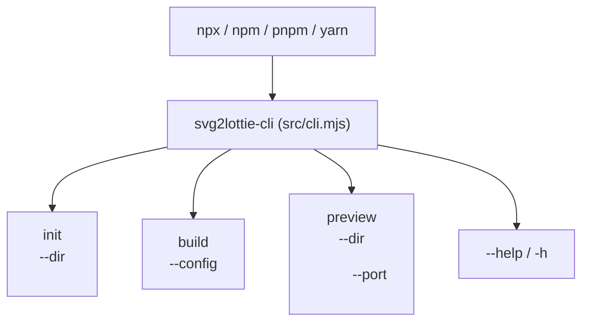

# API・CLI仕様書 (`docs/api-specification.md`)

> **TL;DR** （インターフェース一覧）
> 本プロジェクトは以下の **4つのインターフェース** を提供します。
> 1. **マルチランナー対応 CLI** （`src/cli.mjs`）: `npm` / `npx` / `pnpm` / `yarn` から `init` / `build` / `preview` を実行
> 2. **コア＆文字コンテ API** （`src/*.mjs`）: SVG変換・文字コンテ解析・修正指示フォーマット生成
> 3. **キラーエフェクト・モジュール API** （`src/effects/*.mjs`）: 全17種の独立エフェクトモジュール群
> 4. **検収プレビュー＆AI修正指示スタジオ HTTP API** （`src/preview-server.mjs`）: `127.0.0.1` 限定の検収サーバー

---

## 1. CLI インターフェース (`src/cli.mjs`)

`package.json` の `bin` (`svg2lottie`, `svg2lottie-cli`) により、どのツールからでも起動可能です。



### 1.1 `init` コマンド
文字コンテ（`shooting-script.md`）、設計図（`storyboard.json`）、サンプルSVG（`svg/scene0.svg`）を生成します。

```bash
npx svg2lottie-cli init [--dir <dir>]
# または: pnpm dlx svg2lottie-cli init / yarn dlx svg2lottie-cli init / npm run init
```

| オプション | 短縮 | デフォルト値 | 説明 |
|---|---|---|---|
| `--dir` | `-d` | `.` | 雛形を生成するディレクトリパス |

### 1.2 `build` コマンド
`storyboard.json`（および紐づく `shooting-script.md`・SVG素材）を読み込み、Lottie JSON ファイルを出力します。

```bash
npx svg2lottie-cli build [--config <path>] [--out <dir>]
```

| オプション | 短縮 | デフォルト値 | 説明 |
|---|---|---|---|
| `--config` | `-c` | `storyboard.json` | ストーリーボード定義JSONファイルのパス |
| `--out` | `-o` | `dist` | 出力先ディレクトリパス |

### 1.3 `preview` コマンド
インタラクティブ検収プレビュー＆AI修正指示スタジオを起動します。

```bash
npx svg2lottie-cli preview [--dir <dir>] [--port <port>]
```

| オプション | 短縮 | デフォルト値 | 説明 |
|---|---|---|---|
| `--dir` | `-d` | `.` | 配信対象ディレクトリ（`dist/` や `shooting-script.md` を含むルート） |
| `--port` | `-p` | `4322` | 待受ポート番号（`127.0.0.1` 固定） |

---

## 2. コア＆文字コンテ API (`src/*.mjs`)

### 2.1 `src/path-parser.mjs`
| 関数シグネチャ | 説明 |
|---|---|
| `hexToLottieColor(hex: string): [number, number, number, 1]` | `#RGB` / `#RRGGBB` を Lottie 正規化 RGBA 配列（`0〜1`、小数点4桁丸め）に変換する。 |
| `parseSvgPathToLottieShapes(d: string): LottieShape[]` | SVG Path の `d` 属性文字列を解析し、サブパスごとの `{ c, v, i, o }` 配列に変換する。 |
| `computeShapesCenter(shapes: LottieShape[], fallbackX?: number, fallbackY?: number): [number, number]` | 頂点群のバウンディングボックス中心 `[cx, cy]` を算出する。 |

### 2.2 `src/svg-extractor.mjs`
| 関数シグネチャ | 説明 |
|---|---|
| `validateSafeSvg(svgText: string): void` | `<script>` タグ、`<!ENTITY`、`on*` イベント属性、サイズ超過（10MB超）を拒否する。 |
| `extractPathDsById(svgText: string, targetId?: string): string[]` | 安全性を検証した上で、指定 `id` を持つ要素から `d` 属性配列を抽出する（白座布団 `#fff` は除外）。 |
| `extractViewBox(svgText: string): { width: number, height: number }` | SVG の `viewBox` または `width`/`height` からサイズを抽出する。 |

### 2.3 `src/shooting-script.mjs`（文字コンテ＆修正指示モジュール）
| 関数シグネチャ | 説明 |
|---|---|
| `parseShootingScript(markdownText: string): ParsedShootingScript` | `shooting-script.md` からタイトル、縦横サイズ（`width`, `height`）、`fps`、`durationFrames`、キーワード、回帰防止ガード、シーン別演出・修正履歴を抽出する。 |
| `createDefaultShootingScript(name?: string, options?: { width?: number, height?: number, fps?: number, durationFrames?: number, color?: string }): string` | `init` コマンドで出力する文字コンテ Markdown テンプレート（冒頭の縦横サイズ初期入力欄付き）を生成する。 |
| `formatRevisionInstruction(revision: RevisionInstruction): string` | 検収プレビュー等で入力された修正情報を、AIエージェント／GitHub Issue 貼り付け用の構造化 Markdown に整形する。 |

### 2.4 `src/lottie-builder.mjs`
| 関数シグネチャ | 説明 |
|---|---|
| `buildLottieFromStoryboard(config: StoryboardConfig, svgResolver: (svgPath: string) => string): LottieAnimation` | `StoryboardConfig` と `src/effects/` モジュール群を組み合わせて Lottie JSON を生成する。 |
| `appendPowderEnding(baseLottie: LottieAnimation, config: StoryboardConfig, svgResolver: (svgPath: string) => string): LottieAnimation` | `powder-scatter.mjs` を呼び出し、粉飛散エンディング付きの派生 Lottie JSON を返す。 |

---

## 3. キラーエフェクト・モジュール API (`src/effects/*.mjs`)

すべてのエフェクトは `src/effects/` 配下に1ファイル1モジュールとして独立実装され、`src/effects/index.mjs` の `EFFECT_REGISTRY` と統一パイプライン関数 `applyLayerEffects(layer, effects, context)` によって合成されます。
各エフェクトモジュールは、レイヤー自身のプロパティ（`ks`, `ef`, `masksProperties`, `shapes`, `tm`）を更新するか、付随するオーバーレイ／パーティクル／残像レイヤー配列 `extraLayers` を返す純粋関数として設計します。

| カテゴリ | モジュール (`src/effects/`) | エクスポート関数 | 責務 |
|---|---|---|---|
| **統括** | `index.mjs` | `EFFECT_REGISTRY`, `listEffects()`, `applyLayerEffects(layer, effects, ctx)` | 全17種エフェクトの一覧取得・検証・レイヤーへの順次適用 |
| ① **遷移・出現** | `cross-dissolve.mjs` | `applyCrossDissolve(layer, options, ctx)` | クロスディゾルブ（オーバーラップ不透明度イージング遷移） |
| | `bleed-fade.mjs` | `buildBleedFadeProps(options)`, `applyBleedFade(layer, options, ctx)` | 不透明度(`o`)、全方位スケール(`s`)、Gaussian Blur(`ty:29`)、加算マスク(`mode:'a'`) |
| | `wipe.mjs` | `applyWipe(layer, options, ctx)` | 上下左右・アイリス（円形）の動的マスク頂点アニメーションによるワイプ遷移 |
| | `slide-push-pull.mjs` | `buildMoveKeyframes(options)`, `applySlidePushPull(layer, options, ctx)` | スライドイン・Push/Pull・オーバーシュート付き位置(`ks.p`)キーフレーム構築 |
| | `pop-in.mjs` | `applyPopIn(layer, options, ctx)` | スプリング／バウンス弾性スケール（`0% → 115% → 100%`）のポップ出現 |
| | `trim-stroke.mjs` | `buildTrimStrokeLayer(options)`, `applyTrimStroke(layer, options, ctx)` | 頂点配列・線幅・開始終了フレームから Trim Paths (`ty: 'tm'`) を構築 |
| ② **モーション・時間** | `zoom-slide-spin.mjs` | `applyZoomSlideSpin(layer, options, ctx)` | ズーム拡縮(`ks.s`)・スライド(`ks.p`)・スピン回転(`ks.r`)の複合アニメーション |
| | `transform.mjs` | `applyTransform(layer, options, ctx)` | アンカー・位置・スケール・回転・スキュー(`sk`/`sa`)・不透明度の汎用トランスフォーム |
| | `speed-control.mjs` | `applySpeedControl(layer, options, ctx)` | 倍速・スローモーション（キーフレーム時間スケーリング＆Time Remap `tm`） |
| ③ **色・マスク・キー** | `color-grade.mjs` | `applyColorGrade(layer, options, ctx)` | 色相・彩度・明度・コントラスト・ティント変換によるカラーグレーディング |
| | `mask.mjs` | `applyMask(layer, options, ctx)` | 加算(`a`)・減算(`s`)・交差(`i`)・反転(`inv`)・ぼかし(`f`)・拡張(`x`)マスクの付与 |
| | `ultra-key.mjs` | `applyUltraKey(layer, options, ctx)` | 指定キーカラー（グリーンスクリーン `#00ff00` 等）と許容距離内のシェイプを自動透過・除去 |
| ④ **光学・Apple的UI** | `echo-glow-neon.mjs` | `applyEchoGlowNeon(layer, options, ctx)` | 時間遅延エコー残像レイヤー生成、ガウシアングロー発光、多層ネオン管ストローク生成 |
| | `liquid-glass.mjs` | `applyLiquidGlass(layer, options, ctx)` | すりガラス・グラスプレート・Apple的リキッドグラス（フロストブラー＋スペキュラリム＋屈折シマー） |
| ⑤ **物理・自然・破壊** | `glass-crack.mjs` | `applyGlassCrack(layer, options, ctx)` | 衝撃点からの放射状ひび割れライン（Trim Paths）＋破片シャード飛散レイヤー生成 |
| | `fire.mjs` | `applyFire(layer, options, ctx)` | コア〜外炎の温度グラデーション揺らぎ＋上昇火の粉（エンバー）パーティクル生成 |
| | `water.mjs` | `applyWater(layer, options, ctx)` | 水面リップル波紋リング拡大・流体ウェーブ・水滴スプラッシュレイヤー生成 |
| | `powder-scatter.mjs` | `applyPowderScatter(baseLottie, options)` | 頂点サンプリングから微細粒子レイヤー群を生成し、本体と同期して枠内飛散＆完全透過させる |

---

## 4. HTTP プレビューサーバー仕様 (`src/preview-server.mjs`)

| メソッド | パス | レスポンス | 説明 |
|---|---|---|---|
| `GET` | `/` または `/preview/index.html` | `200 text/html; charset=utf-8` | 検収プレビュー＆AI修正指示スタジオ HTML |
| `GET` | `/effects` または `/effects.html` | `200 text/html; charset=utf-8` | エフェクト専用カタログ・ショールーム HTML（全キラーエフェクト一覧） |
| `GET` | `/api/animations` | `200 application/json` | `dist/` 内の `.json` ファイル一覧 `{ "files": ["..."] }` |
| `GET` | `/dist/<name>.json` | `200 application/json` | 生成された Lottie JSON ファイル |
| `GET` | `/../...` (ディレクトリ外) | `403 text/plain` | パストラバーサル攻撃をブロック (`Forbidden`) |
| `GET` | 存在しないパス | `404 text/plain` | `Not Found` |
# 降雪ループエフェクト

`effects` に `{ "type": "snowfall-loop" }` を指定すると、対象レイヤーを縦方向にタイル複製して循環させます。`start` / `end` はループ区間、`distance` は落下距離、`drift` は左右の揺れ幅、`copies` はタイル数、`opacity` は雪の不透明度です。ループ用Storyboardでは `end` を `durationFrames` と一致させます。
