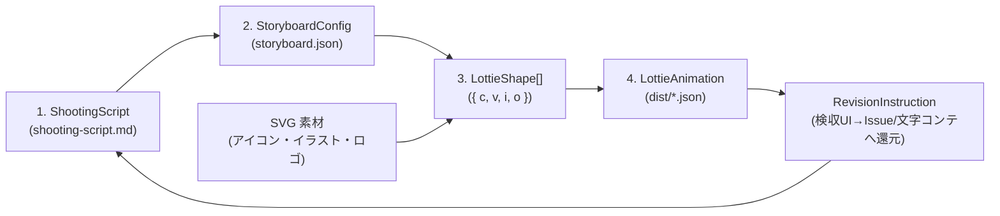
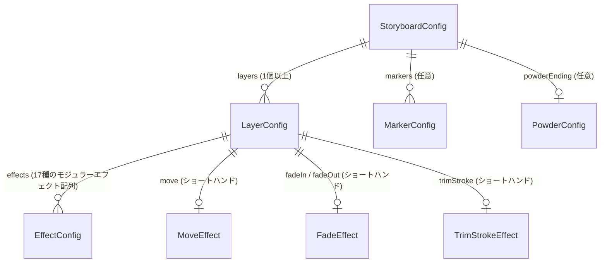

# データモデル設計書 (`docs/data-model.md`)

> **TL;DR** （4つのデータ構造）
> 本ツールはRDBを持たず、以下の **4つのシンプルなデータモデル** をパイプラインで処理します。
> 1. **文字コンテ** （`ShootingScript` / `shooting-script.md`）: 人間とAIが共有するシーン別台本・修正履歴・回帰防止ルール
> 2. **ストーリーボード** （`StoryboardConfig` / `storyboard.json`）: レイヤー・フレーム・モジュール化エフェクトの宣言的設定
> 3. **ベジェ形状** （`LottieShape`）: SVG Path `d` 属性から変換された頂点・接線データ（`{ c, v, i, o }`）
> 4. **Lottie出力** （`LottieAnimation` / `dist/*.json`）: Bodymovin v5.12.2 互換のアニメーションJSON



---

## 1. 文字コンテモデル: `ShootingScript` (`shooting-script.md`)

アニメーション制作の起点となる Markdown 台本モデルです。`src/shooting-script.mjs` でパース・検証・生成を行います。

### Markdown 初期入力欄テンプレートとパース後データ (`ParsedShootingScript`)

```markdown
# 文字コンテ (sample-animation)

## キャンバスサイズ・基本設定（初期入力欄）
- 横幅 (width): 520px
- 縦幅 (height): 140px
- フレームレート (fps): 60fps
- 総フレーム数 (durationFrames): 560f
- ベースカラー (color): #264f74
```

```json
{
  "title": "アニメーションタイトル",
  "width": 520,
  "height": 140,
  "fps": 60,
  "durationFrames": 560,
  "color": "#264f74",
  "keywords": [
    "滲んだようなフェードアウト",
    "透過",
    "Day & Night を考慮して反転を想定",
    "ガウス効果がオブジェクト外にはみ出ないよう"
  ],
  "guards": [
    "0f待機状態のオブジェクトは必ず透過0%を維持する（1f目だけ見えるバグを防ぐ）",
    "背景レイヤーや#fffの白座布団は出力しない"
  ],
  "scenes": [
    {
      "id": "scene0",
      "directions": [
        "お: text-o, し: text-s, ん: text-n, こ: text-k",
        "オブジェクトは透過（0%）で上下左右中央に待機"
      ],
      "revisions": [
        "0f〜40fの中央待機時は透過0%を維持すること"
      ]
    }
  ]
}
```

---

## 2. ストーリーボードモデル: `StoryboardConfig` (`storyboard.json`)

どのSVG要素に、どのエフェクトモジュール（`src/effects/`）を適用するかを宣言するスキーマです。

### 全体構造（ER図）



### ルートオブジェクト (`StoryboardConfig`)

| フィールド | 型 | 必須 | デフォルト値 | 説明 |
|---|---|---|---|---|
| `name` | `string` | ✅ | `"animation"` | アニメーション名（出力ファイル名 `{name}.json` のベース） |
| `width` | `number` | ✅ | `520` | 出力キャンバス幅（px / 元SVGの `viewBox` が `3000px` 等の場合もこのサイズへ自動縮小スケーリング） |
| `height` | `number` | ✅ | `140` | 出力キャンバス高さ（px / 元SVGの `viewBox` からこのサイズへ自動縮小スケーリング） |
| `fps` | `number` | - | `60` | フレームレート（1〜120） |
| `durationFrames` | `number` | ✅ | `560` | 総フレーム数（`op`） |
| `loop` | `boolean` | - | `false` | ループ再生フラグ |
| `color` | `string` | - | `"#264f74"` | デフォルト描画カラー（`#RGB` または `#RRGGBB`） |
| `shootingScript` | `string` | - | `"shooting-script.md"` | 紐づく文字コンテファイルのパス（任意） |
| `interaction` | `InteractionConfig` | - | `undefined` | Web埋め込みおよび検収スタジオ用のインタラクション定義（ホバー・クリック・リンク） |
| `layers` | `LayerConfig[]` | ✅ | - | レイヤー定義の配列 |
| `markers` | `MarkerConfig[]` | - | `[]` | シーンマーカー配列（`{ cm, tm, dr }`） |
| `powderEnding` | `PowderConfig` | - | `undefined` | 粉飛散エンディング派生版（`powder-scatter.mjs`）の生成設定 |

### インタラクション設定 (`InteractionConfig`)

Webサイトや検収スタジオ上で、ユーザーのマウス操作・タップに反応するアニメーション動作を定義します。

| フィールド | 型 | 選択値 | 説明 |
|---|---|---|---|
| `hover` | `string` | `"play" \| "reverse" \| "loop" \| "pause"` | マウスホバー/フォーカス時の挙動（`play`: 先頭から再生、`reverse`: 離れた時逆再生、`loop`: ホバー中のみループ、`pause`: ホバー中停止） |
| `click` | `string` | `"toggle" \| "seek" \| "url"` | クリック/タップ時の挙動（`toggle`: 再生/停止切替、`seek`: 指定フレームへジャンプ、`url`: セキュアな画面遷移） |
| `seekFrame` | `number` | `0 〜 durationFrames` | `click: "seek"` 時にジャンプする目的のフレーム番号 |
| `url` | `string` | 有効なURL | `click: "url"` 時の遷移先（`https://`, `http://`, 許可された相対パスのみ受付、`javascript:` 等は遮断） |
| `target` | `string` | `"_blank" \| "_self"` | リンクの開き方（`_blank` 指定時は `rel="noopener noreferrer"` を強制付与） |

### レイヤー定義 (`LayerConfig`)

| フィールド | 型 | 必須 | 説明 |
|---|---|---|---|
| `id` | `string` | ✅ | レイヤー識別名（Lottieの `nm` に設定） |
| `type` | `"shape" \| "stroke"` | - | デフォルトは `"shape"`。枠線一筆書き時は `"stroke"` |
| `svg` | `string` | 条件付 | 読み込むSVGファイルの相対パス（`type: "shape"` 時必須） |
| `targetId` | `string` | - | SVG内の抽出対象 `<g id="...">` または `<path id="...">`（省略時は全 `<path>`） |
| `pathRange` | `[number, number]` | - | IDを持たないイラストSVGから抽出する `<path>` インデックス範囲 `[startIdx, endIdx]`（両端含む） |
| `pathIndices` | `number[]` | - | 抽出する `<path>` インデックス配列 |
| `keepWhitePaths` | `boolean` | - | `true` の場合、イラスト内部の白色パーツ（`#fff` の波しぶきやハイライト等）も除外せず保持 |
| `preserveColors` | `boolean` | - | `true`（または `color` 省略時）の場合、SVG内の各 `<path>` 固有の `fill` 色や `<linearGradient>` 色を個別保持 |
| `color` | `string` | - | レイヤー単色オーバーライド（指定時は全パスをこの色で統一） |
| `clipMask` | `boolean` | - | `true` の場合、第1パスを加算マスク（`mode: 'a'`）にし、ガウスブラーのはみ出しを防止 |
| `inFrame` | `number` | - | レイヤー出現フレーム `ip`（デフォルト: `0`） |
| `outFrame` | `number` | - | レイヤー消滅フレーム `op`（デフォルト: `durationFrames`） |
| `initialOpacity` | `number` | - | `fadeIn` 前の待機時不透明度 `0〜100`（デフォルト: `fadeIn` がある場合は `0`、なければ `100`） |
| `effects` | `EffectConfig[]` | - | **統一モジュラーエフェクト配列**（下記17種の `{ "type": "...", ... }` を順番に合成適用） |
| `move` | `MoveEffect` | - | ショートハンド: `slide-push-pull.mjs` による移動展開設定 |
| `fadeIn` / `fadeOut` | `FadeEffect` | - | ショートハンド: `bleed-fade.mjs` によるフェードイン／アウト設定 |
| `trimStroke` | `TrimStrokeEffect` | 条件付 | ショートハンド: `trim-stroke.mjs` による頂点・線幅・Trim Paths 設定 |
| `trim` | `TrimPathsModifier` | - | **パスのトリミング** (`ty: "tm"`): 線の開始・終了・オフセットアニメーション |
| `offsetPaths` | `OffsetPathsModifier` | - | **パスのオフセット** (`ty: "op"`): パスの拡大・縮小・肉付け |
| `mergePaths` | `MergePathsModifier` | - | **パスの結合** (`ty: "mm"`): パス同士のAdd/Subtract/Intersectブーリアン |
| `repeater` | `RepeaterModifier` | - | **リピーター** (`ty: "rp"`): シェイプの配列複製・回転・弾ける演出 |
| `roundCorners` | `RoundCornersModifier` | - | **角を丸くする** (`ty: "rd"`): パス頂点の動的角丸半径 |
| `gradientFill` | `GradientFillModifier` | - | **グラデーション塗り** (`ty: "gf"`): 線形/放射状グラデーション塗り |
| `gradientStroke` | `GradientStrokeModifier` | - | **グラデーション線** (`ty: "gs"`): 線形/放射状グラデーション線 |

### Lottie ネイティブ・シェイプモディファイア定義 (`ShapeModifiers`)

AEのシェイプレイヤー「追加（Add）」メニューに対応する、Lottieの核となるネイティブ機能群です。

#### 1. パスのトリミング (`TrimPathsModifier` / `ty: "tm"`)
```json
"trim": {
  "startKeyframes": [{ "frame": 0, "value": 0 }, { "frame": 45, "value": 0 }, { "frame": 90, "value": 75 }],
  "endKeyframes": [{ "frame": 0, "value": 15 }, { "frame": 45, "value": 85 }, { "frame": 90, "value": 90 }],
  "offsetKeyframes": [{ "frame": 0, "value": 0 }, { "frame": 90, "value": 360 }],
  "mode": "simultaneously"
}
```
- `fill: false`: 塗りを停止し、線（Stroke）のみの美しいローディングスピナーを描画
- `start` (`s`), `end` (`e`), `offset` (`o`): 単一補間または複数キーフレームによる動的制御
- `mode` (`m`): `1`=同時にトリミング (`simultaneously`), `2`=個別にトリミング (`individually`)

#### 2. パスのオフセット (`OffsetPathsModifier` / `ty: "op"`)
```json
"offsetPaths": {
  "amount": 24,
  "fromAmount": 2,
  "lineJoin": "round",
  "miterLimit": 4,
  "startFrame": 0,
  "endFrame": 45
}
```
- `amount` (`a`): オフセット量（px、正の値で拡大・肉付け、負の値で縮小、キーフレーム指定可）
- `lineJoin` (`lj`): 結合スタイル (`1`=miter, `2`=round, `3`=bevel、デフォルト: `round`)
- `miterLimit` (`ml`): マイター限界（デフォルト: `4`）

#### 3. パスの結合 (`MergePathsModifier` / `ty: "mm"`)
```json
"mergePaths": {
  "mode": "add",
  "animateApproach": true,
  "distance": 60,
  "filletRadius": 24
}
```
- `mode` (`mm`): `1`=Merge, `2`=Add（合体）, `3`=Subtract（型抜き）, `4`=Intersect（交差）, `5`=Exclude（中マド除外）
- 左右から中央へ接近した2つの円が重なり、結合部のくびれに滑らかなR（フィレットベジェ角丸）が動的に加わって合体・分離するアニメーションに対応。
- ※ Web(SVG)プレイヤーで完全動作。iOS/Androidネイティブでは一部制限があるため注意。

#### 4. リピーター (`RepeaterModifier` / `ty: "rp"`)
```json
"repeater": {
  "copies": 8,
  "fromCopies": 1,
  "position": [0, 0],
  "anchor": [0, 0],
  "rotation": 45,
  "startFrame": 0,
  "endFrame": 45
}
```
- `copies` (`c`): 複製数（動的キーフレームにより 1個から 8個へと次々に配列複製）
- `transform` (`tr`): インスタンス間の相対増分（デルタ）。回転(`r`)・位置(`p`)・拡大縮小(`s`)により円状または直線状に整然と配列複製。

#### 5. 角を丸くする (`RoundCornersModifier` / `ty: "rd"`)
```json
"roundCorners": {
  "radius": 42,
  "fromRadius": 0,
  "startFrame": 0,
  "endFrame": 45
}
```
- `radius` (`r`): 角丸半径（px、デフォルト: `10`、キーフレーム指定可）

#### 6. グラデーション塗り & 線 (`GradientFillModifier` / `ty: "gf"`, `GradientStrokeModifier` / `ty: "gs"`)
```json
"gradientFill": {
  "type": "linear",
  "fromStart": [-120, -120],
  "start": [450, 450],
  "fromEnd": [0, 0],
  "end": [570, 570],
  "startFrame": 0,
  "endFrame": 90,
  "stops": [
    { "offset": 0, "color": "#06b6d4" },
    { "offset": 0.5, "color": "#8b5cf6" },
    { "offset": 1, "color": "#ec4899" }
  ]
}
```
- `s` (start), `e` (end): 始点・終点の動的キーフレームにより、光が無限に流れ続けるシマー効果を実現。
  "type": "linear",
  "start": [0, 0],
  "end": [520, 0],
  "stops": [
    { "offset": 0, "color": "#38bdf8" },
    { "offset": 1, "color": "#0284c7" }
  ],
  "opacity": 100
}
```
- `type` (`t`): `1`=linear（線形）, `2`=radial（放射状）
- `start` (`s`): 開始座標 `[x, y]`
- `end` (`e`): 終了座標 `[x, y]`
- `stops` (`g`): カラー分岐点配列 (`offset`: 0〜1, `color`: HEX文字列)
- `width` (`w`): 線の場合の太さ（`gradientStroke` のみ）

### 17種のモジュラーエフェクト設定スキーマ (`EffectConfig`)

`LayerConfig.effects` 配列に `{ "type": "<effectType>", ...options }` を追加するだけで、任意の数のエフェクトを宣言的に重ね掛けできます。

| `type` 識別子 | 対応モジュール (`src/effects/`) | 主な設定プロパティ (`options`) |
|---|---|---|
| `"cross-dissolve"` | `cross-dissolve.mjs` | `direction: "in" \| "out"`, `start`, `end`, `curve?: "easeInOut" \| "linear"` |
| `"bleed-fade"` | `bleed-fade.mjs` | `fadeIn?: { start, end, blur?: 24, scaleFrom?: 0 }`, `fadeOut?: { start, end, blur?: 24, scaleTo?: 0 }` |
| `"wipe"` | `wipe.mjs` | `direction: "left" \| "right" \| "up" \| "down" \| "iris"`, `start`, `end`, `feather?: 0` |
| `"slide-push-pull"` | `slide-push-pull.mjs` | `mode?: "slide" \| "push" \| "pull"`, `dx`, `dy`, `start`, `end`, `overshoot?: 0` |
| `"pop-in"` | `pop-in.mjs` | `start`, `end`, `overshootScale?: 115`, `fromScale?: 0` |
| `"trim-stroke"` | `trim-stroke.mjs` | `vertices`, `closed?: true`, `strokeWidth?: 4`, `start`, `end` |
| `"zoom-slide-spin"` | `zoom-slide-spin.mjs` | `start`, `end`, `zoomFrom?: 100`, `zoomTo?: 100`, `dx?: 0`, `dy?: 0`, `rotations?: 1` |
| `"transform"` | `transform.mjs` | `position?: [x, y]`, `scale?: [sx, sy]`, `rotation?: deg`, `skew?: deg`, `skewAxis?: deg`, `opacity?: 0..100` |
| `"speed-control"` | `speed-control.mjs` | `rate: number` (`2.0`=倍速, `0.5`=スロー), `freezeFrame?: number` |
| `"color-grade"` | `color-grade.mjs` | `tintColor?: string`, `hueShift?: deg`, `saturation?: number`, `brightness?: number`, `contrast?: number` |
| `"mask"` | `mask.mjs` | `mode: "a" \| "s" \| "i"`, `inverted?: false`, `feather?: 0`, `expansion?: 0`, `vertices?: [x,y][]` |
| `"ultra-key"` | `ultra-key.mjs` | `keyColor?: "#00ff00"`, `tolerance?: 0.25` (対象色に近いパス・塗りを自動透過/除外) |
| `"echo-glow-neon"` | `echo-glow-neon.mjs` | `mode: "echo" \| "glow" \| "neon"`, `color?: string`, `blur?: 18`, `echoCount?: 3`, `echoDelayFrames?: 3` |
| `"liquid-glass"` | `liquid-glass.mjs` | `variant?: "frosted" \| "plate" \| "liquid"`, `blur?: 20`, `tintOpacity?: 22`, `specularWidth?: 1.5`, `refraction?: 12` |
| `"glass-crack"` | `glass-crack.mjs` | `start`, `end`, `impactPoint?: [cx, cy]`, `rays?: 8`, `rings?: 3`, `shatter?: true` |
| `"fire"` | `fire.mjs` | `start`, `end`, `intensity?: 1.0`, `coreColor?: "#fff3b0"`, `flameColor?: "#ff5400"`, `emberCount?: 24` |
| `"water"` | `water.mjs` | `mode?: "ripple" \| "wave" \| "splash" \| "dripping"`, `start`, `end`, `rings?: 3`, `amplitude?: 12`, `color?: "#38bdf8"` |
| `"snowfall-loop"` | `snowfall-loop.mjs` | `start?: 0`, `end?: durationFrames`, `distance?: canvasHeight`, `drift?: 24`, `copies?: 2`, `opacity?: 85` |
| `"powder-scatter"` | `powder-scatter.mjs` | ルート `powderEnding` またはレイヤー単位で頂点サンプリング粒子飛散を生成 |

#### 代表的な設定例（JSON）

```json
{
  "id": "glass-card",
  "svg": "svg/card.svg",
  "clipMask": true,
  "fadeIn": { "start": 0, "end": 40, "blur": 24, "scaleFrom": 0 },
  "effects": [
    { "type": "pop-in", "start": 0, "end": 36, "overshootScale": 108 },
    { "type": "liquid-glass", "variant": "liquid", "blur": 20, "tintOpacity": 25, "specularWidth": 2 },
    { "type": "echo-glow-neon", "mode": "glow", "color": "#38bdf8", "blur": 16 }
  ]
}
```

---

## 3. 構造化修正指示モデル: `RevisionInstruction`

検収プレビュー画面または `formatRevisionInstruction()` が生成する、AIエージェント／GitHub Issue 向けの修正指示データモデルです。

| フィールド | 型 | 必須 | 説明 |
|---|---|---|---|
| `fileName` | `string` | ✅ | 検収対象の JSON ファイル名（例: `"logo-animation.json"`） |
| `scene` | `string` | ✅ | 対象シーン名（例: `"scene2"`） |
| `frame` | `number` | ✅ | 指摘箇所のフレーム番号（例: `148`） |
| `totalFrames` | `number` | - | 総フレーム数（例: `560`） |
| `layerId` | `string` | ✅ | 修正対象のレイヤーID（例: `"o"` または `"全体"`） |
| `instruction` | `string` | ✅ | 具体的な修正内容（例: `"フェードイン開始を10f遅らせる"`） |
| `guards` | `string[]` | - | 壊してはいけない回帰防止チェックリスト |

---

## 4. 中間モデル (`LottieShape`) & 出力モデル (`LottieAnimation`)

- **中間シェイプ** （`LottieShape`）: `{ c: boolean, v: [number, number][], i: [number, number][], o: [number, number][] }`
- **最終アニメーション** （`LottieAnimation`）: `{ v: "5.12.2", fr, ip: 0, op, w, h, nm, ddd: 0, loop, assets: [], layers, markers }`

---

## 5. ローカル検収状態 (`PreviewWorkspaceState`)

ブラウザ内だけに保存する再開用モデルです。

| フィールド | 型 | 説明 |
|---|---|---|
| `currentFile` | `string` | 最後に検収していたLottie JSON |
| `frameByFile` | `Record<string, number>` | ファイル別の最終フレーム |
| `progressByFile` | `Record<string, "unreviewed" | "reviewing" | "needs-fix" | "approved">` | ファイル別検収状態 |
| `memoByFile` | `Record<string, string>` | ファイル別の修正メモ下書き |
| `layerByFile` | `Record<string, string>` | ファイル別の選択レイヤー |
| `speed` / `zoom` / `background` | `string` | 表示・再生設定 |
| `savedAt` | `string` | 最終保存日時（ISO 8601） |
| `revisionItems` | `RevisionContract[]` | 上書きされない複数の変更Inboxカード |

## 6. 変更契約 (`RevisionContract`)

曖昧な気づきと実装可能な指示を分離し、承認前の指示がAgentへ渡らないようにするローカルデータモデルです。

| フィールド | 型 | 必須 | 説明 |
|---|---|---|---|
| `id` | `string` | ✅ | ブラウザ内で一意なカードID |
| `fileName` / `scene` / `frame` / `totalFrames` | `string` / `string` / `number` / `number` | ✅ | 指摘を記録した検収位置 |
| `layerId` | `string` | ✅ | 変更対象レイヤー。全体変更は明示的に `全体` |
| `observation` | `string` | ✅ | 現状・気になったこと |
| `expectedResult` | `string` | ✅ | 期待する見た目・振る舞い |
| `allowedChanges` | `string` | ✅ | 変更してよい範囲・プロパティ |
| `forbiddenChanges` | `string` | ✅ | 変更してはいけない範囲 |
| `acceptanceCriteria` | `string` | ✅ | 再検収可能な完了条件 |
| `openQuestions` | `string` | - | 不明点。値がある間は承認不可 |
| `priority` | `"required" | "optional" | "hold"` | ✅ | 必須・任意・保留 |
| `status` | `"draft" | "review" | "approved" | "recheck" | "done"` | ✅ | 変更契約の進行状態 |
| `createdAt` / `updatedAt` | `string` | ✅ | 作成・更新日時 |

`approved` への遷移には、必須の契約項目がすべて入力済みで `openQuestions` が空であることを要求します。Agent向けMarkdownの生成対象も `approved` のカードだけです。
