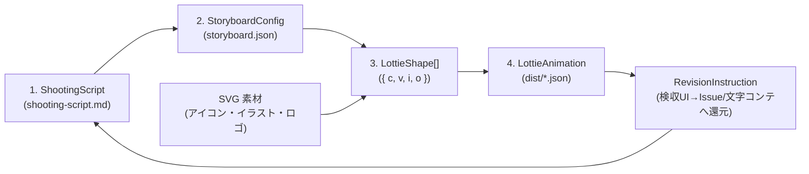
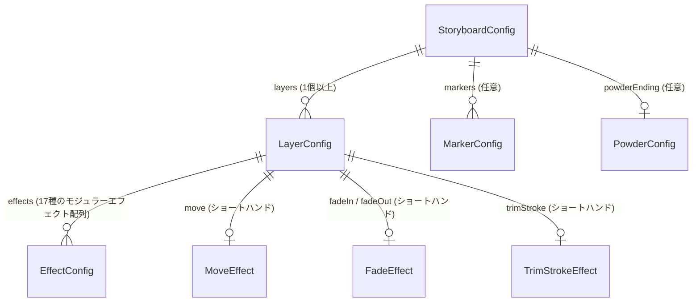

# データモデル設計書 (`docs/data-model.md`)

> **TL;DR** （4つのデータ構造）
> 本ツールはRDBを持たず、以下の **4つのシンプルなデータモデル** をパイプラインで処理します。
> 1. **文字コンテ** （`ShootingScript` / `shooting-script.md`）: 人間とAIが共有するシーン別台本・修正履歴・回帰防止ルール
> 2. **ストーリーボード** （`StoryboardConfig` / `storyboard.json`）: レイヤー・フレーム・モジュール化エフェクトの宣言的設定
> 3. **ベジェ形状** （`LottieShape`）: SVG Path `d` 属性から変換された頂点・接線データ（`{ c, v, i, o }`）
> 4. **Lottie出力** （`LottieAnimation` / `dist/*.json`）: Bodymovin v5.12.2 互換のアニメーションJSON



---

## 1. 文字コンテモデル: `ShootingScript` (`shooting-script.md`)

アニメーション制作の起点となる Markdown 台本モデルです。`src/shooting-script.mjs` でパース・検証・生成を行います。

### Markdown 初期入力欄テンプレートとパース後データ (`ParsedShootingScript`)

```markdown
# 文字コンテ (sample-animation)

## キャンバスサイズ・基本設定（初期入力欄）
- 横幅 (width): 520px
- 縦幅 (height): 140px
- フレームレート (fps): 60fps
- 総フレーム数 (durationFrames): 560f
- ベースカラー (color): #264f74
```

```json
{
  "title": "アニメーションタイトル",
  "width": 520,
  "height": 140,
  "fps": 60,
  "durationFrames": 560,
  "color": "#264f74",
  "keywords": [
    "滲んだようなフェードアウト",
    "透過",
    "Day & Night を考慮して反転を想定",
    "ガウス効果がオブジェクト外にはみ出ないよう"
  ],
  "guards": [
    "0f待機状態のオブジェクトは必ず透過0%を維持する（1f目だけ見えるバグを防ぐ）",
    "背景レイヤーや#fffの白座布団は出力しない"
  ],
  "scenes": [
    {
      "id": "scene0",
      "directions": [
        "お: text-o, し: text-s, ん: text-n, こ: text-k",
        "オブジェクトは透過（0%）で上下左右中央に待機"
      ],
      "revisions": [
        "0f〜40fの中央待機時は透過0%を維持すること"
      ]
    }
  ]
}
```

---

## 2. ストーリーボードモデル: `StoryboardConfig` (`storyboard.json`)

どのSVG要素に、どのエフェクトモジュール（`src/effects/`）を適用するかを宣言するスキーマです。

### 全体構造（ER図）



### ルートオブジェクト (`StoryboardConfig`)

| フィールド | 型 | 必須 | デフォルト値 | 説明 |
|---|---|---|---|---|
| `name` | `string` | ✅ | `"animation"` | アニメーション名（出力ファイル名 `{name}.json` のベース） |
| `width` | `number` | ✅ | `520` | キャンバス幅（px / 正の数値） |
| `height` | `number` | ✅ | `140` | キャンバス高さ（px / 正の数値） |
| `fps` | `number` | - | `60` | フレームレート（1〜120） |
| `durationFrames` | `number` | ✅ | `560` | 総フレーム数（`op`） |
| `loop` | `boolean` | - | `false` | ループ再生フラグ |
| `color` | `string` | - | `"#264f74"` | デフォルト描画カラー（`#RGB` または `#RRGGBB`） |
| `shootingScript` | `string` | - | `"shooting-script.md"` | 紐づく文字コンテファイルのパス（任意） |
| `layers` | `LayerConfig[]` | ✅ | - | レイヤー定義の配列 |
| `markers` | `MarkerConfig[]` | - | `[]` | シーンマーカー配列（`{ cm, tm, dr }`） |
| `powderEnding` | `PowderConfig` | - | `undefined` | 粉飛散エンディング派生版（`powder-scatter.mjs`）の生成設定 |

### レイヤー定義 (`LayerConfig`)

| フィールド | 型 | 必須 | 説明 |
|---|---|---|---|
| `id` | `string` | ✅ | レイヤー識別名（Lottieの `nm` に設定） |
| `type` | `"shape" \| "stroke"` | - | デフォルトは `"shape"`。枠線一筆書き時は `"stroke"` |
| `svg` | `string` | 条件付 | 読み込むSVGファイルの相対パス（`type: "shape"` 時必須） |
| `targetId` | `string` | - | SVG内の抽出対象 `<g id="...">` または `<path id="...">`（省略時は全 `<path>`） |
| `color` | `string` | - | レイヤー個別の色（省略時はルートの `color` を継承） |
| `clipMask` | `boolean` | - | `true` の場合、第1パスを加算マスク（`mode: 'a'`）にし、ガウスブラーのはみ出しを防止 |
| `inFrame` | `number` | - | レイヤー出現フレーム `ip`（デフォルト: `0`） |
| `outFrame` | `number` | - | レイヤー消滅フレーム `op`（デフォルト: `durationFrames`） |
| `initialOpacity` | `number` | - | `fadeIn` 前の待機時不透明度 `0〜100`（デフォルト: `fadeIn` がある場合は `0`、なければ `100`） |
| `effects` | `EffectConfig[]` | - | **統一モジュラーエフェクト配列**（下記17種の `{ "type": "...", ... }` を順番に合成適用） |
| `move` | `MoveEffect` | - | ショートハンド: `slide-push-pull.mjs` による移動展開設定 |
| `fadeIn` / `fadeOut` | `FadeEffect` | - | ショートハンド: `bleed-fade.mjs` によるフェードイン／アウト設定 |
| `trimStroke` | `TrimStrokeEffect` | 条件付 | ショートハンド: `trim-stroke.mjs` による頂点・線幅・Trim Paths 設定 |

### 17種のモジュラーエフェクト設定スキーマ (`EffectConfig`)

`LayerConfig.effects` 配列に `{ "type": "<effectType>", ...options }` を追加するだけで、任意の数のエフェクトを宣言的に重ね掛けできます。

| `type` 識別子 | 対応モジュール (`src/effects/`) | 主な設定プロパティ (`options`) |
|---|---|---|
| `"cross-dissolve"` | `cross-dissolve.mjs` | `direction: "in" \| "out"`, `start`, `end`, `curve?: "easeInOut" \| "linear"` |
| `"bleed-fade"` | `bleed-fade.mjs` | `fadeIn?: { start, end, blur?: 24, scaleFrom?: 0 }`, `fadeOut?: { start, end, blur?: 24, scaleTo?: 0 }` |
| `"wipe"` | `wipe.mjs` | `direction: "left" \| "right" \| "up" \| "down" \| "iris"`, `start`, `end`, `feather?: 0` |
| `"slide-push-pull"` | `slide-push-pull.mjs` | `mode?: "slide" \| "push" \| "pull"`, `dx`, `dy`, `start`, `end`, `overshoot?: 0` |
| `"pop-in"` | `pop-in.mjs` | `start`, `end`, `overshootScale?: 115`, `fromScale?: 0` |
| `"trim-stroke"` | `trim-stroke.mjs` | `vertices`, `closed?: true`, `strokeWidth?: 4`, `start`, `end` |
| `"zoom-slide-spin"` | `zoom-slide-spin.mjs` | `start`, `end`, `zoomFrom?: 100`, `zoomTo?: 100`, `dx?: 0`, `dy?: 0`, `rotations?: 1` |
| `"transform"` | `transform.mjs` | `position?: [x, y]`, `scale?: [sx, sy]`, `rotation?: deg`, `skew?: deg`, `skewAxis?: deg`, `opacity?: 0..100` |
| `"speed-control"` | `speed-control.mjs` | `rate: number` (`2.0`=倍速, `0.5`=スロー), `freezeFrame?: number` |
| `"color-grade"` | `color-grade.mjs` | `tintColor?: string`, `hueShift?: deg`, `saturation?: number`, `brightness?: number`, `contrast?: number` |
| `"mask"` | `mask.mjs` | `mode: "a" \| "s" \| "i"`, `inverted?: false`, `feather?: 0`, `expansion?: 0`, `vertices?: [x,y][]` |
| `"ultra-key"` | `ultra-key.mjs` | `keyColor?: "#00ff00"`, `tolerance?: 0.25` (対象色に近いパス・塗りを自動透過/除外) |
| `"echo-glow-neon"` | `echo-glow-neon.mjs` | `mode: "echo" \| "glow" \| "neon"`, `color?: string`, `blur?: 18`, `echoCount?: 3`, `echoDelayFrames?: 3` |
| `"liquid-glass"` | `liquid-glass.mjs` | `variant?: "frosted" \| "plate" \| "liquid"`, `blur?: 20`, `tintOpacity?: 22`, `specularWidth?: 1.5`, `refraction?: 12` |
| `"glass-crack"` | `glass-crack.mjs` | `start`, `end`, `impactPoint?: [cx, cy]`, `rays?: 8`, `rings?: 3`, `shatter?: true` |
| `"fire"` | `fire.mjs` | `start`, `end`, `intensity?: 1.0`, `coreColor?: "#fff3b0"`, `flameColor?: "#ff5400"`, `emberCount?: 24` |
| `"water"` | `water.mjs` | `mode?: "ripple" \| "wave" \| "splash"`, `start`, `end`, `rings?: 3`, `amplitude?: 12`, `color?: "#38bdf8"` |
| `"powder-scatter"` | `powder-scatter.mjs` | ルート `powderEnding` またはレイヤー単位で頂点サンプリング粒子飛散を生成 |

#### 代表的な設定例（JSON）

```json
{
  "id": "glass-card",
  "svg": "svg/card.svg",
  "clipMask": true,
  "fadeIn": { "start": 0, "end": 40, "blur": 24, "scaleFrom": 0 },
  "effects": [
    { "type": "pop-in", "start": 0, "end": 36, "overshootScale": 108 },
    { "type": "liquid-glass", "variant": "liquid", "blur": 20, "tintOpacity": 25, "specularWidth": 2 },
    { "type": "echo-glow-neon", "mode": "glow", "color": "#38bdf8", "blur": 16 }
  ]
}
```

---

## 3. 構造化修正指示モデル: `RevisionInstruction`

検収プレビュー画面または `formatRevisionInstruction()` が生成する、AIエージェント／GitHub Issue 向けの修正指示データモデルです。

| フィールド | 型 | 必須 | 説明 |
|---|---|---|---|
| `fileName` | `string` | ✅ | 検収対象の JSON ファイル名（例: `"logo-animation.json"`） |
| `scene` | `string` | ✅ | 対象シーン名（例: `"scene2"`） |
| `frame` | `number` | ✅ | 指摘箇所のフレーム番号（例: `148`） |
| `totalFrames` | `number` | - | 総フレーム数（例: `560`） |
| `layerId` | `string` | ✅ | 修正対象のレイヤーID（例: `"o"` または `"全体"`） |
| `instruction` | `string` | ✅ | 具体的な修正内容（例: `"フェードイン開始を10f遅らせる"`） |
| `guards` | `string[]` | - | 壊してはいけない回帰防止チェックリスト |

---

## 4. 中間モデル (`LottieShape`) & 出力モデル (`LottieAnimation`)

- **中間シェイプ** （`LottieShape`）: `{ c: boolean, v: [number, number][], i: [number, number][], o: [number, number][] }`
- **最終アニメーション** （`LottieAnimation`）: `{ v: "5.12.2", fr, ip: 0, op, w, h, nm, ddd: 0, loop, assets: [], layers, markers }`
