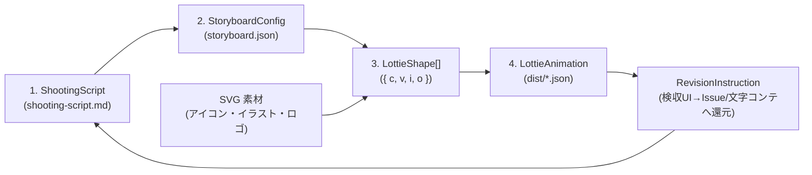
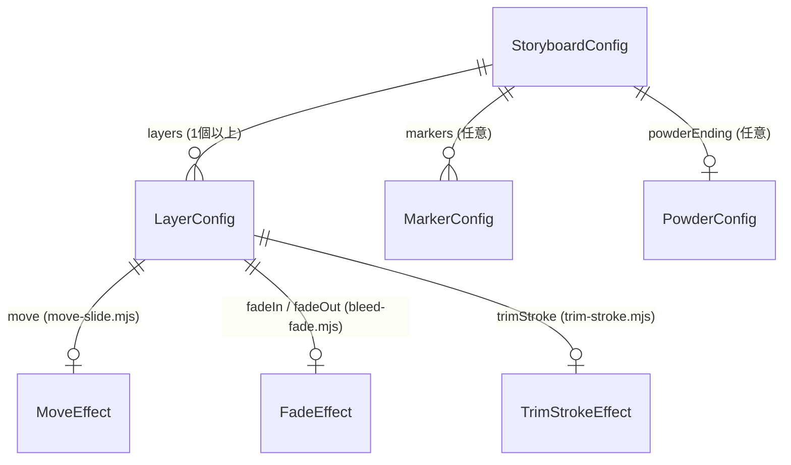

# データモデル設計書 (`docs/data-model.md`)

> **TL;DR（4つのデータ構造）**
> 本ツールはRDBを持たず、以下の **4つのシンプルなデータモデル** をパイプラインで処理します。
> 1. **文字コンテ (`ShootingScript` / `shooting-script.md`)**: 人間とAIが共有するシーン別台本・修正履歴・回帰防止ルール
> 2. **ストーリーボード (`StoryboardConfig` / `storyboard.json`)**: レイヤー・フレーム・モジュール化エフェクトの宣言的設定
> 3. **ベジェ形状 (`LottieShape`)**: SVG Path `d` 属性から変換された頂点・接線データ（`{ c, v, i, o }`）
> 4. **Lottie出力 (`LottieAnimation` / `dist/*.json`)**: Bodymovin v5.12.2 互換のアニメーションJSON



---

## 1. 文字コンテモデル: `ShootingScript` (`shooting-script.md`)

アニメーション制作の起点となる Markdown 台本モデルです。`src/shooting-script.mjs` でパース・検証・生成を行います。

### Markdown 構造とパース後データ (`ParsedShootingScript`)

```json
{
  "title": "アニメーションタイトル",
  "keywords": [
    "滲んだようなフェードアウト",
    "透過",
    "Day & Night を考慮して反転を想定",
    "ガウス効果がオブジェクト外にはみ出ないよう"
  ],
  "guards": [
    "0f待機状態のオブジェクトは必ず透過0%を維持する（1f目だけ見えるバグを防ぐ）",
    "背景レイヤーや#fffの白座布団は出力しない"
  ],
  "scenes": [
    {
      "id": "scene0",
      "directions": [
        "お: text-o, し: text-s, ん: text-n, こ: text-k",
        "オブジェクトは透過（0%）で上下左右中央に待機"
      ],
      "revisions": [
        "0f〜40fの中央待機時は透過0%を維持すること"
      ]
    }
  ]
}
```

---

## 2. ストーリーボードモデル: `StoryboardConfig` (`storyboard.json`)

どのSVG要素に、どのエフェクトモジュール（`src/effects/`）を適用するかを宣言するスキーマです。

### 全体構造（ER図）



### ルートオブジェクト (`StoryboardConfig`)

| フィールド | 型 | 必須 | デフォルト値 | 説明 |
|---|---|---|---|---|
| `name` | `string` | ✅ | `"animation"` | アニメーション名（出力ファイル名 `{name}.json` のベース） |
| `width` | `number` | ✅ | `520` | キャンバス幅（px / 正の数値） |
| `height` | `number` | ✅ | `140` | キャンバス高さ（px / 正の数値） |
| `fps` | `number` | - | `60` | フレームレート（1〜120） |
| `durationFrames` | `number` | ✅ | `560` | 総フレーム数（`op`） |
| `loop` | `boolean` | - | `false` | ループ再生フラグ |
| `color` | `string` | - | `"#264f74"` | デフォルト描画カラー（`#RGB` または `#RRGGBB`） |
| `shootingScript` | `string` | - | `"shooting-script.md"` | 紐づく文字コンテファイルのパス（任意） |
| `layers` | `LayerConfig[]` | ✅ | - | レイヤー定義の配列 |
| `markers` | `MarkerConfig[]` | - | `[]` | シーンマーカー配列（`{ cm, tm, dr }`） |
| `powderEnding` | `PowderConfig` | - | `undefined` | 粉飛散エンディング派生版（`powder-scatter.mjs`）の生成設定 |

### レイヤー定義 (`LayerConfig`)

| フィールド | 型 | 必須 | 説明 |
|---|---|---|---|
| `id` | `string` | ✅ | レイヤー識別名（Lottieの `nm` に設定） |
| `type` | `"shape" \| "stroke"` | - | デフォルトは `"shape"`。枠線一筆書き時は `"stroke"` |
| `svg` | `string` | 条件付 | 読み込むSVGファイルの相対パス（`type: "shape"` 時必須） |
| `targetId` | `string` | - | SVG内の抽出対象 `<g id="...">` または `<path id="...">`（省略時は全 `<path>`） |
| `color` | `string` | - | レイヤー個別の色（省略時はルートの `color` を継承） |
| `clipMask` | `boolean` | - | `true` の場合、第1パスを加算マスク（`mode: 'a'`）にし、ガウスブラーのはみ出しを防止 |
| `inFrame` | `number` | - | レイヤー出現フレーム `ip`（デフォルト: `0`） |
| `outFrame` | `number` | - | レイヤー消滅フレーム `op`（デフォルト: `durationFrames`） |
| `initialOpacity` | `number` | - | `fadeIn` 前の待機時不透明度 `0〜100`（デフォルト: `fadeIn` がある場合は `0`、なければ `100`） |
| `move` | `MoveEffect` | - | `src/effects/move-slide.mjs` による移動展開設定 |
| `fadeIn` | `FadeEffect` | - | `src/effects/bleed-fade.mjs` による滲んだフェードイン＋センター拡大設定 |
| `fadeOut` | `FadeEffect` | - | `src/effects/bleed-fade.mjs` による滲んだフェードアウト＋センター縮小設定 |
| `trimStroke` | `TrimStrokeEffect` | 条件付 | `src/effects/trim-stroke.mjs` による頂点・線幅・Trim Paths 設定 |

### エフェクトモジュール別設定スキーマ

#### ① `bleed-fade` (`fadeIn` / `fadeOut`)
```json
{
  "fadeIn": {
    "start": 40,
    "end": 90,
    "blur": 24,
    "scaleFrom": 0
  },
  "fadeOut": {
    "start": 140,
    "end": 176,
    "blur": 24,
    "scaleTo": 0
  }
}
```
- `blur`: ガウシアンブラー最大値（デフォルト `24` px）。
- `scaleFrom` / `scaleTo`: センター（アンカーポイント `[cx, cy]`）から全方位への拡縮率（`0` 指定で `0% ↔ 100%`、`100` 指定で拡縮なし）。

#### ② `move-slide` (`move`)
```json
{
  "move": {
    "dx": 170.36,
    "dy": 0,
    "start": 40,
    "end": 110
  }
}
```
- `0f 〜 start` まで `[cx + dx, cy + dy]` で待機し、`start 〜 end` で定位置 `[cx, cy]` へ Cubic Bezier (`0.22, 1, 0.36, 1`) で移動します。

#### ③ `trim-stroke` (`trimStroke`)
```json
{
  "trimStroke": {
    "vertices": [[470, 20], [50, 20], [50, 120], [470, 120]],
    "closed": true,
    "strokeWidth": 4,
    "start": 452,
    "end": 504
  }
}
```
- `vertices` の並び順により描画開始点と回転方向（右上から左回り等）を自在に制御します。

#### ④ `powder-scatter` (`powderEnding`)
```json
{
  "powderEnding": {
    "enabled": true,
    "targetLayerIds": ["co-op", "frame-stroke"],
    "appearFrame": 628,
    "fadeStartFrame": 630,
    "fadeEndFrame": 690,
    "totalFrames": 720,
    "particleCount": 3456,
    "loop": true
  }
}
```

---

## 3. 構造化修正指示モデル: `RevisionInstruction`

検収プレビュー画面または `formatRevisionInstruction()` が生成する、AIエージェント／GitHub Issue 向けの修正指示データモデルです。

| フィールド | 型 | 必須 | 説明 |
|---|---|---|---|
| `fileName` | `string` | ✅ | 検収対象の JSON ファイル名（例: `"logo-animation.json"`） |
| `scene` | `string` | ✅ | 対象シーン名（例: `"scene2"`） |
| `frame` | `number` | ✅ | 指摘箇所のフレーム番号（例: `148`） |
| `totalFrames` | `number` | - | 総フレーム数（例: `560`） |
| `layerId` | `string` | ✅ | 修正対象のレイヤーID（例: `"o"` または `"全体"`） |
| `instruction` | `string` | ✅ | 具体的な修正内容（例: `"フェードイン開始を10f遅らせる"`） |
| `guards` | `string[]` | - | 壊してはいけない回帰防止チェックリスト |

---

## 4. 中間モデル (`LottieShape`) & 出力モデル (`LottieAnimation`)

- **`LottieShape`**: `{ c: boolean, v: [number, number][], i: [number, number][], o: [number, number][] }`
- **`LottieAnimation`**: `{ v: "5.12.2", fr, ip: 0, op, w, h, nm, ddd: 0, loop, assets: [], layers, markers }`
