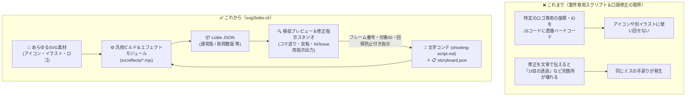
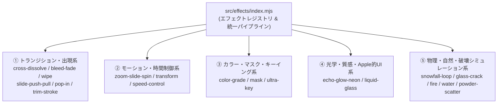

# 要件定義書 (`docs/requirements.md`)

> **TL;DR**（結論から！）
> - **何を作る？**: ロゴだけでなく **UIアイコン・ヒーローイラスト・キャラクター・バッジ等あらゆるSVG素材** と **文字コンテ**（`shooting-script.md`）から、Lottieアニメーションを構築・検収・修正指示できる汎用CLIツール。
> - **どのツールで動く？**: `npm` / `npx` / `pnpm` / `yarn` すべてに完全対応。
> - **3大コアピラー**:
>   1. **文字コンテ駆動**（`shooting-script.md`）: 文字コンテがなければ構築できない。台本と回帰防止ルールを一元管理。
>   2. **検収プレビュー＆AI修正指示スタジオ**（最重要）: コマ送り検収しながら、 **どのフレームのどの要素をどう直すかを構造化Markdownで即コピー**（GitHub Issue形式にも対応）してAIエージェントに正確に伝えられる。
>   3. **キラーエフェクトのモジュール化**（`src/effects/`）: 滲んだフェード・リキッドグラス・炎・水・粉飛散（Powder）・一筆書き等の全17種をモジュール化し、新エフェクトを随時追加可能にする。

---

## 1. 全体イメージ（Before / After）

---

## 2. 機能要件（Functional Requirements）

### FR-1: マルチパッケージマネージャー対応 CLI（`npm` / `npx` / `pnpm` / `yarn`）
- `package.json` の `bin` フィールドと `#!/usr/bin/env node` により、`npx svg2lottie-cli`、`pnpm dlx svg2lottie-cli`、`yarn dlx svg2lottie-cli`、および `npm run` / `pnpm` / `yarn` スクリプトのすべてで同一動作すること。
- サブコマンド:
  - `init`: `shooting-script.md`（文字コンテ）、`storyboard.json`、サンプル `svg/scene0.svg` を生成。
  - `build`: 文字コンテ・Storyboard定義とSVGから Lottie JSON を出力。
  - `preview`: 検収プレビュー＆AI修正指示スタジオをローカル起動。

### FR-2: 文字コンテ（`shooting-script.md`）機能（構築の起点）
- アニメーション構築の起点として、人間とAIエージェントが共通理解を持てる **文字コンテ** （`shooting-script.md`）を必須コンポーネントとして扱うこと。
- 文字コンテの初期入力欄には **縦横のサイズ記載欄** （横幅 `width` px・縦幅 `height` px・フレームレート `fps`・総フレーム数 `durationFrames`・ベースカラー `color`）を標準で備えること。
- 文字コンテには以下を含め、パーサー（`src/shooting-script.mjs`）で構造化データの抽出およびバリデーションを行えること：
  1. **キャンバスサイズ・基本設定** （初期入力欄：横幅 `width` px、縦幅 `height` px、フレームレート `fps`、総フレーム数 `durationFrames`、ベースカラー `color`）
  2. **全体仕様・キーワード** （透過、Day & Night 反転、はみ出し防止など）
  3. **シーン別演出** （`## scene0`, `## scene1` ... の対象要素IDと動きの指定）
  4. **絶対維持ルール** （回帰防止ガード：修正時にAIが壊してはいけないルール、例「0f待機時は必ず透過0%を維持」）
  5. **構造化修正履歴 / Issue テンプレート形式** （対象フレーム・対象レイヤーID・修正内容）

### FR-3: 修正方法の改善（Agent / GitHub Issue 連携）
AIエージェントへの修正指示で「どこを直せばいいか曖昧」「直したら別の場所が壊れた」を根絶するため、以下の仕組みを備えること：
- **構造化修正フォーマット**（Markdown / GitHub Issue 両対応）:
  - 修正指示には必ず **対象JSONファイル・対象シーン＆フレーム番号・対象レイヤーID・現状の課題と期待する動作・回帰防止チェックリスト** の5項目を含める。
- **GitHub Issue テンプレート同梱**:
  - `.github/ISSUE_TEMPLATE/animation-revision.md`（アニメーション修正指示用）と `.github/ISSUE_TEMPLATE/effect-request.md`（新規キラーエフェクト追加用）を備え、Issueベースでもエージェントに正確無比な指示を出せること。

### FR-4: インタラクティブ検収プレビュー機能（最重要！）
単なる再生プレイヤーではなく、 **正方形（1:1 / 3000×3000px等）・横長（ワイド / 3500×1423px等）あらゆるアスペクト比を高精度に検収し、ダメ出し（修正指示プロンプト生成）までが1画面で完結するスタジオ** であること：
- **アスペクト比自動フィット＆ズーム検収**: 正方形・横長・縦長どんな高解像度SVG/Lottieでもステージ枠内に自動フィット（`Auto-Fit`）し、`50%` / `100%` / `150%` / `200%` ズーム切替が可能。
- **精密検収ガイド（ルーラー・十字センター・三分割グリッド・境界枠）**: 中心ズレやガウスブラーのはみ出しを1px単位で目視検査できるガイドオーバーレイ切替。
- **背景プリセット＆Day & Night 検査**: 透過チェッカーボード、ダーク背景（白要素検収用）、ライト背景、Dark Mode、Day & Night 色反転（`filter: invert(1) brightness(2)`）切替。
- **レイヤー別インスペクター（表示/非表示切替＆対象IDワンクリック選択）**: 各レイヤーのON/OFFを切り替えて個別検収でき、クリックで修正対象レイヤーIDに即セットできること。
- **再生・コマ送り・速度・シーンジャンプ制御**: `Space`（再生/停止）、`◀ 1f` / `1f ▶`（1フレーム移動）、フレーム番号＋秒数（`0.00s`）表示、速度切替（`0.25x〜1.5x`）、`markers` 連動シーンジャンプ。
- **AI修正指示 / Issue ジェネレーターパネル**:
  - 現在の停止フレーム番号・キャンバス縦横サイズ・現在のシーン名・レイヤー一覧を自動セットし、修正メモを入力するだけで **Agent / GitHub Issue 貼り付け用の構造化Markdown** を生成・ワンクリックコピーできること。

### FR-5: エフェクトのモジュール化（`src/effects/`）と17種のキラーエフェクト群
エフェクト処理を `lottie-builder.mjs` に密結合させず、`src/effects/` 配下に **1ファイル1エフェクト** でモジュール化し、`storyboard.json` のレイヤー定義（`effects: [{ "type": "..." }]` またはショートハンドプロパティ）から宣言的に呼び出せるアーキテクチャとすること：

| カテゴリ | モジュール (`src/effects/`) | エフェクト概要 |
|---|---|---|
| ① **トランジション・出現** | `cross-dissolve.mjs` | **ディゾルブ**（クロスディゾルブ）: シーン・レイヤー間の滑らかなオーバーラップ遷移 |
| | `bleed-fade.mjs` | **フェードIn/Out**（通常＆滲んだフェード）: 不透明度＋センター全方位拡縮＋ガウスブラー(`ty:29`)＋加算マスク(`mode:'a'`) |
| | `wipe.mjs` | **ワイプ**: 上下左右・斜め・円形（アイリス）・クロックの動的マスクワイプ |
| | `slide-push-pull.mjs` | **スライドイン**（Push / Pull）: 押し出し・引き込み・オーバーシュート付きスライド遷移 |
| | `pop-in.mjs` | **ポップイン**: 弾性（バウンス／スプリング）イージングによるポップ出現 |
| | `trim-stroke.mjs` | **一筆書き枠線**: 任意の頂点・パスを Trim Paths（`0% → 100%`）で描画 |
| ② **モーション・時間制御** | `zoom-slide-spin.mjs` | **ズーム・スライド・スピン**: カメラ的拡大縮小・平行移動・回転の複合プリセット |
| | `transform.mjs` | **トランスフォーム**: 位置・アンカー・スケール・回転・スキュー（傾斜）・不透明度の汎用制御 |
| | `speed-control.mjs` | **スピード調整**（倍速・スロー・フリーズ）: キーフレーム時間伸縮・Time Remap（`tm`）制御 |
| ③ **カラー・マスク・キー** | `color-grade.mjs` | **カラーコレクション・グレーディング**: 色相・彩度・明度・コントラスト・ティント・LUT風トーン変換 |
| | `mask.mjs` | **マスク**: 加算(`a`)・減算(`s`)・交差(`i`)・反転(`inv`)・ぼかし(`f`)・拡張(`x`)の汎用マスク構築 |
| | `ultra-key.mjs` | **Ultraキー**（グリーンスクリーン）: 指定キーカラー（`#00ff00` 等）および許容範囲内の色要素を自動透過・除去 |
| ④ **光学・質感・Apple的UI** | `echo-glow-neon.mjs` | **エコー / グロー / ネオン**: 残像レイヤー複製（エコー）、発光ブルーム、多層ネオン管ストローク生成 |
| | `liquid-glass.mjs` | **すりガラス・グラスプレート・リキッドグラス**（Apple的）: 半透明フロストブラー＋スペキュラハイライト枠＋流体屈折シマー |
| ⑤ **物理・自然・破壊** | `glass-crack.mjs` | **ガラスひび割れ**: 衝撃点からの放射状クラックライン一筆書き＋破片シャード飛散 |
| | `snowfall-loop.mjs` | **降雪ループ**: SVG内の雪片レイヤーを縦方向へタイル複製し、横揺れを加えながら開始・終了フレームが一致するシームレスな降雪を生成 |
| | `fire.mjs` | **炎エフェクト**: コア〜外炎の温度グラデーション揺らぎ＋上昇火の粉（エンバー）パーティクル |
| | `water.mjs` | **水エフェクト**: 波紋（リップル）リング拡散＋流体ウェーブ変形＋水滴スプラッシュ |
| | `powder-scatter.mjs` | **粉飛散パーティクル**（Powder）: 頂点サンプリング微細粒子の出現・枠内放射飛散・完全透過(`0%`) |

### FR-6: SVG Path → Lottie ベジェ形状への高精度変換
- SVG `<path d="...">` の全コマンド（`M`, `L`, `H`, `V`, `C`, `S`, `Q`, `T`, `A`, `Z`、絶対/相対）を解析し、Lottie Shape `{ c, v, i, o }` へ変換。
- 円弧（`A`/`a`）の3次ベジェ近似、小数点4桁丸め、バウンディングボックス中心 `[cx, cy]` の自動算出。

---

## 3. 非機能要件（Security 1st / a11y 2nd / KISS）

### NFR-1: セキュリティ要件（最優先）
| 項目 | 仕様 |
|---|---|
| **外部依存ゼロ** | `package.json` の `dependencies` は空（0個）。Node.js 標準APIのみで実装する。 |
| **パストラバーサル防止** | `storyboard.json` 内の `svg` パスやプレビューサーバーのURLがベースディレクトリ外（`..`）を指す場合は即座に拒否する。 |
| **SVG無害化チェック** | `<script>` タグ、`<!ENTITY`（XXE攻撃）、`on*` イベント属性、10MB超のSVGはエラーとして拒否する。 |
| **ローカルホスト限定** | プレビューサーバーは `127.0.0.1` のみにバインドする。 |
| **HTTPセキュリティヘッダー** | `Content-Security-Policy`, `X-Content-Type-Options: nosniff`, `X-Frame-Options: DENY`, `Referrer-Policy: no-referrer` を常時付与する。 |

### NFR-2: アクセシビリティ要件（a11y 第二優先）
| 項目 | 仕様 |
|---|---|
| **キーボード完全操作** | `Tab` 移動、`Space`（再生/停止）、`←`/`→`（1f送り/戻し）、`Home`（先頭）で全操作が可能。 |
| **スクリーンリーダー対応** | 全コントロールに `aria-label` または `<label>` を付与。状態通知は `<output aria-live="polite">` を使用。 |
| **動きの軽減への配慮** | `prefers-reduced-motion: reduce` 環境では初回ロード時の自動再生をOFF（一時停止状態）で開始する。 |
| **コントラスト確保** | ライト／ダーク双方でコントラスト比 `4.5:1` 以上を確保し、`:focus-visible` アウトラインを明示する。 |
