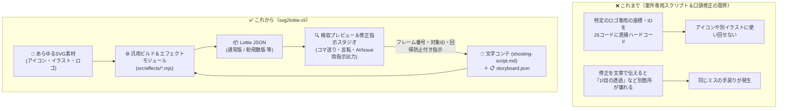
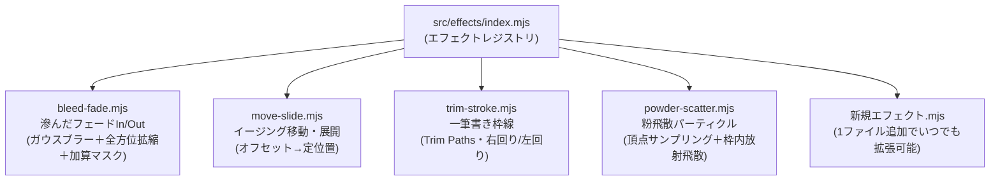

# 要件定義書 (`docs/requirements.md`)

> **TL;DR（結論から！）**
> - **何を作る？**: ロゴだけでなく**UIアイコン・ヒーローイラスト・キャラクター・バッジ等あらゆるSVG素材**と**文字コンテ（`shooting-script.md`）**から、Lottieアニメーションを構築・検収・修正指示できる汎用CLIツール。
> - **どのツールで動く？**: `npm` / `npx` / `pnpm` / `yarn` すべてに完全対応。
> - **3大コアピラー**:
>   1. **文字コンテ駆動（`shooting-script.md`）**: 文字コンテがなければ構築できない。台本と回帰防止ルールを一元管理。
>   2. **検収プレビュー＆AI修正指示スタジオ（最重要）**: コマ送り検収しながら、**「どのフレームのどの要素をどう直すか」を構造化Markdown（またはGitHub Issue形式）で即コピー**してAIエージェントに正確に伝えられる。
>   3. **キラーエフェクトのモジュール化（`src/effects/`）**: 滲んだフェード・粉飛散（Powder）・一筆書き等をモジュール化し、新エフェクトを随時追加可能にする。

---

## 1. 全体イメージ（Before / After）

---

## 2. 機能要件（Functional Requirements）

### FR-1: マルチパッケージマネージャー対応 CLI（`npm` / `npx` / `pnpm` / `yarn`）
- `package.json` の `bin` フィールドと `#!/usr/bin/env node` により、`npx svg2lottie-cli`、`pnpm dlx svg2lottie-cli`、`yarn dlx svg2lottie-cli`、および `npm run` / `pnpm` / `yarn` スクリプトのすべてで同一動作すること。
- サブコマンド:
  - `init`: `shooting-script.md`（文字コンテ）、`storyboard.json`、サンプル `svg/scene0.svg` を生成。
  - `build`: 文字コンテ・Storyboard定義とSVGから Lottie JSON を出力。
  - `preview`: 検収プレビュー＆AI修正指示スタジオをローカル起動。

### FR-2: 文字コンテ（`shooting-script.md`）機能（構築の起点）
- アニメーション構築の起点として、人間とAIエージェントが共通理解を持てる **文字コンテ（`shooting-script.md`）** を必須コンポーネントとして扱うこと。
- 文字コンテには以下を含め、パーサー（`src/shooting-script.mjs`）で構造化データの抽出およびバリデーションを行えること：
  1. **全体仕様・キーワード**（キャンバスサイズ、ベースカラー、透過、Day & Night 反転、はみ出し防止など）
  2. **シーン別演出（`## scene0`, `## scene1` ...）**（対象要素IDと動きの指定）
  3. **絶対維持ルール（回帰防止ガード）**（修正時にAIが壊してはいけないルール：例「0f待機時は必ず透過0%を維持」）
  4. **構造化修正履歴 / Issue テンプレート形式**（対象フレーム・対象レイヤーID・修正内容）

### FR-3: 修正方法の改善（Agent / GitHub Issue 連携）
AIエージェントへの修正指示で「どこを直せばいいか曖昧」「直したら別の場所が壊れた」を根絶するため、以下の仕組みを備えること：
- **構造化修正フォーマット（Markdown / GitHub Issue 両対応）**:
  - 修正指示には必ず **①対象JSONファイル、②対象シーン＆フレーム番号、③対象レイヤーID、④現状の課題と期待する動作、⑤回帰防止チェックリスト** を含める。
- **GitHub Issue テンプレート同梱**:
  - `.github/ISSUE_TEMPLATE/animation-revision.md`（アニメーション修正指示用）と `.github/ISSUE_TEMPLATE/effect-request.md`（新規キラーエフェクト追加用）を備え、Issueベースでもエージェントに正確無比な指示を出せること。

### FR-4: インタラクティブ検収プレビュー機能（最重要！）
単なる再生プレイヤーではなく、**「検収（コマ送り・視覚検査）＋ダメ出し（修正指示プロンプト生成）」が1画面で完結するスタジオ**であること：
- **再生・コマ送り制御**: 再生/停止、先頭へ戻る、シークバー、`◀ 1f` / `1f ▶` の1フレーム単位ステップ移動。
- **速度切替**: `0.25x` / `0.5x` / `0.75x` / `1.0x` / `1.5x` のワンクリック切替。
- **動的シーンジャンプ**: 読み込んだ Lottie JSON の `markers`（`scene0`, `scene1` ...）から自動でジャンプボタンを生成。
- **視覚・透過・Day & Night 検査**:
  - 透過グリッド表示、Dark Mode 切替、Day & Night 色反転（`filter: invert(1) brightness(2)`）切替、ループ ON/OFF。
  - 現在のJSON名・粒子数・総フレーム数・キャンバスサイズを常時表示。
- **AI修正指示 / Issue ジェネレーターパネル**:
  - 現在の停止フレーム番号・現在のシーン名・レイヤー一覧（JSONから自動抽出）を自動セットし、修正メモを入力するだけで **「Agent / GitHub Issue 貼り付け用の構造化Markdown」** を生成・ワンクリックコピーできること。

### FR-5: エフェクトのモジュール化（`src/effects/`）とキラーエフェクト群
エフェクト処理を `lottie-builder.mjs` に密結合させず、`src/effects/` 配下にモジュール化し、新しいキラーエフェクトを随時追加できるアーキテクチャとすること：

1. **`bleed-fade`（滲んだフェードイン／アウト & はみ出し防止マスク）**:
   - 不透明度（`0% ↔ 100%`）、センター基準の全方位スケール（`0% ↔ 100%` 等）、ガウシアンブラー（`ty: 29`、`24px ↔ 0px` 等）を連動。
   - `clipMask: true` 指定時は第1パスを加算マスク（`masksProperties` `mode: 'a'`）として適用し、ガウス効果がオブジェクト外にはみ出ないようにクリップする。
2. **`move-slide`（移動・展開）**:
   - 初期オフセット `[dx, dy]` から定位置 `[cx, cy]` への Cubic Bezier イージング移動。
3. **`trim-stroke`（一筆書き枠線）**:
   - 任意の頂点またはパスに対し、開始点・回転方向・線幅を指定して Trim Paths（`0% → 100%`）で描画。
4. **`powder-scatter`（粉飛散パーティクル）**:
   - 指定レイヤー群の頂点をサンプリングして微細粒子を出現させ、対象レイヤーと同じタイミングでフェードアウトしながらキャンバス枠内で外向きに飛散し、完全透過（`0%`）へ戻す。

### FR-6: SVG Path → Lottie ベジェ形状への高精度変換
- SVG `<path d="...">` の全コマンド（`M`, `L`, `H`, `V`, `C`, `S`, `Q`, `T`, `A`, `Z`、絶対/相対）を解析し、Lottie Shape `{ c, v, i, o }` へ変換。
- 円弧（`A`/`a`）の3次ベジェ近似、小数点4桁丸め、バウンディングボックス中心 `[cx, cy]` の自動算出。

---

## 3. 非機能要件（Security 1st / a11y 2nd / KISS）

### NFR-1: セキュリティ要件（最優先）
| 項目 | 仕様 |
|---|---|
| **外部依存ゼロ** | `package.json` の `dependencies` は空（0個）。Node.js 標準APIのみで実装する。 |
| **パストラバーサル防止** | `storyboard.json` 内の `svg` パスやプレビューサーバーのURLがベースディレクトリ外（`..`）を指す場合は即座に拒否する。 |
| **SVG無害化チェック** | `<script>` タグ、`<!ENTITY`（XXE攻撃）、`on*` イベント属性、10MB超のSVGはエラーとして拒否する。 |
| **ローカルホスト限定** | プレビューサーバーは `127.0.0.1` のみにバインドする。 |
| **HTTPセキュリティヘッダー** | `Content-Security-Policy`, `X-Content-Type-Options: nosniff`, `X-Frame-Options: DENY`, `Referrer-Policy: no-referrer` を常時付与する。 |

### NFR-2: アクセシビリティ要件（a11y 第二優先）
| 項目 | 仕様 |
|---|---|
| **キーボード完全操作** | `Tab` 移動、`Space`（再生/停止）、`←`/`→`（1f送り/戻し）、`Home`（先頭）で全操作が可能。 |
| **スクリーンリーダー対応** | 全コントロールに `aria-label` または `<label>` を付与。状態通知は `<output aria-live="polite">` を使用。 |
| **動きの軽減への配慮** | `prefers-reduced-motion: reduce` 環境では初回ロード時の自動再生をOFF（一時停止状態）で開始する。 |
| **コントラスト確保** | ライト／ダーク双方でコントラスト比 `4.5:1` 以上を確保し、`:focus-visible` アウトラインを明示する。 |
